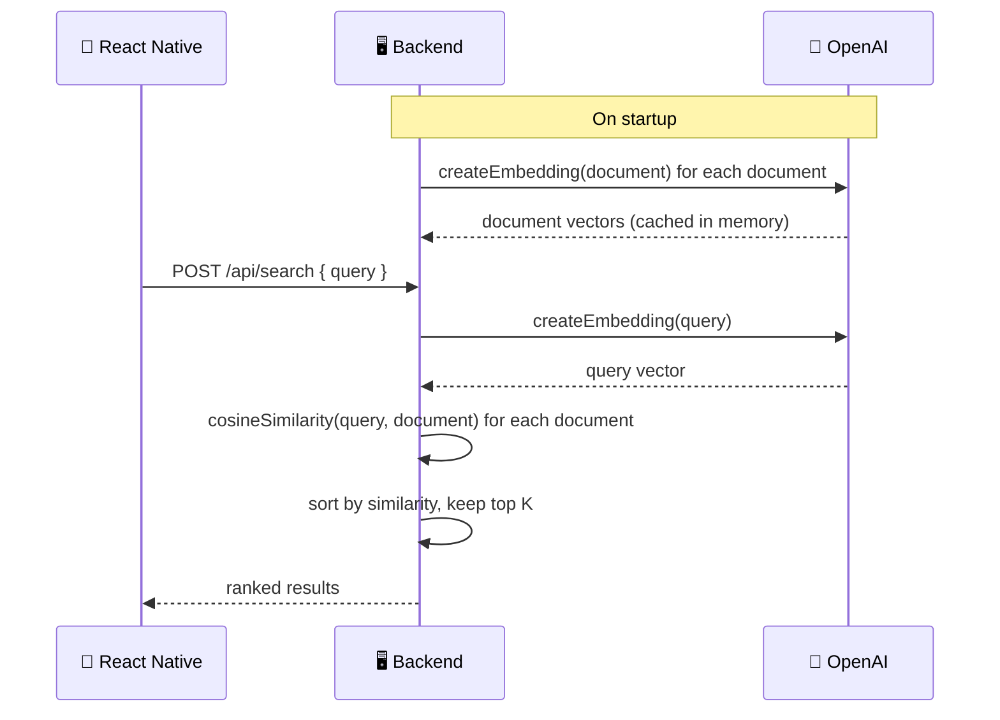

# 🔍 Semantic Search

### Experiment 04 — RAG Embeddings & Semantic Search


This experiment moves away from keyword matching and builds **semantic search** on top of **OpenAI embeddings** and **cosine similarity** — the retrieval half of a RAG (Retrieval-Augmented Generation) pipeline.

The application is a small **knowledge-base search tool**. A user asks a question in plain language, and the backend returns the documents that are closest in *meaning*, not the ones that merely share words.

---

## 📑 Table of Contents

- [Core Concept](#-core-concept)
- [What We Build](#-what-we-build)
- [How It Works](#-how-it-works)
- [Hands-On Labs](#-hands-on-labs)
- [API](#-api)
- [Project Structure](#-project-structure)
- [Backend Setup](#-backend-setup)
- [Test the Backend](#-test-the-backend)
- [Run the Mobile Application](#-run-the-mobile-application)
- [Security](#-security)
- [What We Learned](#-what-we-learned)
- [About Harihar Code Studio](#-about-harihar-code-studio)

---

## 💡 Core Concept

> **Keyword search matches words. Semantic search matches meaning.**

Every document and every query is converted into an **embedding** — a vector of numbers that represents its meaning. Finding the best match is then just geometry:

> **The smaller the angle between two vectors, the more similar their meaning — measured with cosine similarity.**

This lets a query like *"How long do I have to get my money back?"* match a document about a *"refund policy"*, even though they don't share a single keyword.

---

## 🏗 What We Build

The application consists of two parts:

| Part | Stack |
| --- | --- |
| 📱 **Mobile app** | React Native / Expo |
| 🖥 **Backend** | Node.js / TypeScript (plain `http`, no framework) |

### Backend Responsibilities

1. Loading the knowledge-base documents.
2. Creating an OpenAI embedding for every document once, at startup (`buildIndex`).
3. Creating an embedding for each incoming query.
4. Scoring every document against the query with cosine similarity.
5. Ranking and returning the top-K most similar documents.

---

## 🔄 How It Works

**Example query:**

> *How long do I have to get my money back?*



---

## 🧪 Hands-On Labs

Before wiring up the API, this experiment works through five small standalone scripts that build intuition one step at a time.

| Lab | Script | What it shows |
| --- | --- | --- |
| 01 | `npm run lab:1` | Why plain keyword search fails on *"How long do I have to get my money back?"* |
| 02 | `npm run lab:2` | What an embedding actually looks like — dimensions, raw values, vector length |
| 03 | `npm run lab:3` | Cosine similarity computed on small, hand-checkable vectors |
| 04 | `npm run lab:4` | A full similarity matrix — every question vs. every document |
| 05 | `npm run lab:5` | Edge cases: typos, a non-English query, and where embeddings get fooled by negation |

> [!NOTE]
> Lab 05 shows that embeddings aren't perfect — *"I want a refund"* and *"I do not want a refund"* still score as highly similar, since embeddings capture topic more than logical negation.

---

## 📡 API

| Endpoint | Method | Body | Returns |
| --- | --- | --- | --- |
| `/health` | `GET` | — | Service status |
| `/api/search` | `POST` | `{ "query": string }` | Query + ranked `{ id, content, similarity }[]` |

**Example response**

```json
{
  "query": "How long do I have to get my money back?",
  "results": [
    {
      "id": "doc-1",
      "content": "Our refund policy allows customers to request a refund within 30 days of purchase.",
      "similarity": 0.6123
    }
  ]
}
```

---

## 🗂 Project Structure

```text
experiment-04/
├── mobile/
│   └── src/
│       ├── api/
│       │   └── search.ts
│       └── app/
│           └── index.tsx
│
└── part-1/
    └── server/
        ├── src/
        │   ├── documents.ts
        │   ├── embeddings.ts
        │   ├── similarity.ts
        │   ├── search.ts
        │   ├── server.ts
        │   ├── index.ts
        │   └── labs/
        │       ├── 01-keyword-search.ts
        │       ├── 02-see-an-embedding.ts
        │       ├── 03-cosine-by-hand.ts
        │       ├── 04-similarity-matrix.ts
        │       └── 05-edge-cases.ts
        │
        ├── package.json
        └── tsconfig.json
```

---

## 🚀 Backend Setup

Navigate to the server:

```bash
cd part-1/server
```

Install dependencies:

```bash
npm install
```

Create a `.env` file:

```env
OPENAI_API_KEY=your_openai_api_key_here
```

> Never commit the real `.env` file or an actual API key.

Start the development server:

```bash
npm run dev
```

The server runs on **http://localhost:3001**

---

## 🧪 Test the Backend

**Health Check**

```bash
curl http://localhost:3001/health
```

**Semantic Search**

```bash
curl -X POST http://localhost:3001/api/search \
  -H "Content-Type: application/json" \
  -d '{"query":"How long do I have to get my money back?"}'
```

**Run a lab**

```bash
npm run lab:1
```

---

## 📱 Run the Mobile Application

Navigate to the mobile application:

```bash
cd mobile
```

Install dependencies:

```bash
npm install
```

Start Expo:

```bash
npx expo start
```

> [!IMPORTANT]
> The app calls the API at `http://localhost:3001` (see `src/api/search.ts`). On a physical device or simulator that can't reach `localhost`, update `API_URL` to your machine's LAN IP address.

The mobile application sends the user's query to:

```http
POST /api/search
```

The backend handles embedding the query, scoring it against the knowledge base, and returning ranked results.

---

## 🔐 Security

> [!WARNING]
> - The OpenAI API key belongs on the **backend**.
> - The React Native application should **not** contain the OpenAI API key.
> - The `.env` file should **never** be committed to Git.
> - CORS is left open (`*`) for local development only — restrict it before shipping this anywhere real.

---

## 📚 What We Learned

- [x] Why keyword search breaks down on natural-language questions
- [x] What an embedding is and how to create one
- [x] Cosine similarity, computed by hand and in code
- [x] Building an in-memory semantic search index
- [x] Ranking and returning top-K results
- [x] Where embeddings get fooled (negation, near-duplicate phrasing)
- [x] Embeddings holding up across typos and languages
- [x] Building a minimal HTTP API without a framework
- [x] React Native integration
- [x] Server-side API key security

---

## ✅ Experiment Status

**Experiment 04 — Part 1: Completed**

### ⏭ Next

Part 2 builds on this retrieval step toward a full RAG pipeline — feeding the retrieved documents into an LLM to generate a grounded answer. See [`part-2/README.md`](./part-2/README.md).

---

## 🎓 About Harihar Code Studio

**Harihar Code Studio** focuses on practical software engineering tutorials covering:

`React Native` · `Mobile Engineering` · `Artificial Intelligence` · `LLM Integrations` · `AI Architecture` · `Developer Tools` · `Production Engineering`

The goal is to understand not only **how** to implement a feature, but also the **architecture and engineering decisions** behind it.
