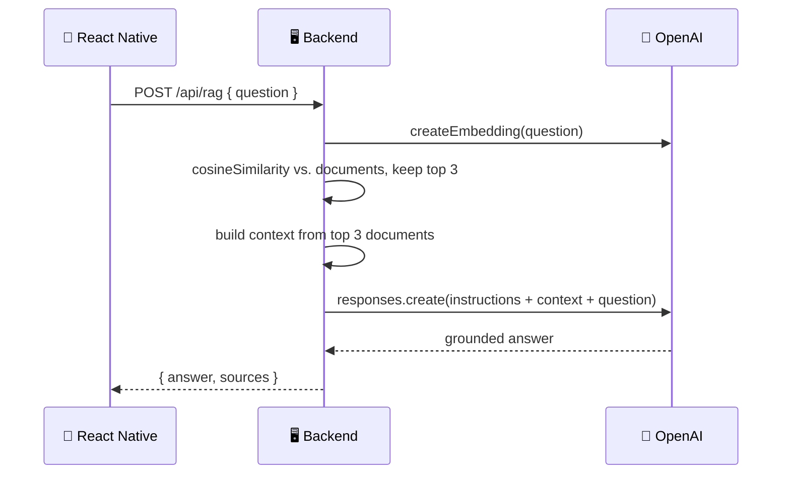

# 🤖 Grounded AI Answers

### Experiment 04 — Part 2: RAG (Retrieval-Augmented Generation)


Part 1 taught our application how to **find** the right information with semantic search. Part 2 teaches it how to **use** that information to generate an answer.

This is a complete **RAG pipeline**: we retrieve the most relevant documents for a question, feed them to an LLM as context, and the model answers **using only that context** — no invented facts.

---

## 📑 Table of Contents

- [Core Concept](#-core-concept)
- [What We Build](#-what-we-build)
- [How It Works](#-how-it-works)
- [API](#-api)
- [Project Structure](#-project-structure)
- [Backend Setup](#-backend-setup)
- [Test the Backend](#-test-the-backend)
- [Run the Mobile Application](#-run-the-mobile-application)
- [Security](#-security)
- [What We Learned](#-what-we-learned)
- [About Harihar Code Studio](#-about-harihar-code-studio)

---

## 💡 Core Concept

> **RAG = Retrieval + Augmented + Generation**

1. **Retrieve** — find the documents closest in meaning to the question (Part 1's semantic search).
2. **Augment** — insert those documents into the model's prompt as context.
3. **Generate** — ask the model to answer using only that context.

Semantic search is not replaced by RAG — it's the first stage of it. Retrieval decides *what* the model is allowed to see; generation decides *how* it's phrased. If retrieval returns the wrong documents, the model is reasoning over bad context, no matter how good it is.

---

## 🏗 What We Build

| Part | Stack |
| --- | --- |
| 📱 **Mobile app** | React Native / Expo (standalone app, separate from Part 1) |
| 🖥 **Backend** | Node.js / TypeScript (plain `http`, no framework) |

> [!NOTE]
> Part 2 has its own `server` and `mobile`, instead of extending Part 1's. Both parts' servers listen on the same port, so keeping them separate means you can run either one on its own without the two colliding.

### Backend Responsibilities (`rag.ts`)

1. Run semantic search to retrieve the top 3 documents for the question.
2. Build a labeled context block from those documents.
3. Send the context + question to `gpt-5.6`, instructed to answer **only** from that context.
4. Return the generated answer together with the sources it was grounded in.

---

## 🔄 How It Works

**Example question:**

> *How long do I have to get my money back?*



> [!IMPORTANT]
> The model is instructed to say it doesn't have enough information rather than guess, if the answer isn't present in the retrieved context.

---

## 📡 API

| Endpoint | Method | Body | Returns |
| --- | --- | --- | --- |
| `/health` | `GET` | — | Service status |
| `/api/rag` | `POST` | `{ "question": string }` | Question + generated `answer` + ranked `sources[]` |

**Example response**

```json
{
  "question": "How long do I have to get my money back?",
  "answer": "You can request a refund within 30 days of purchase.",
  "sources": [
    {
      "id": "doc-1",
      "content": "Our refund policy allows customers to request a refund within 30 days of purchase.",
      "similarity": 0.6123
    }
  ]
}
```

---

## 🗂 Project Structure

```text
experiment-04/part-2/
├── mobile/
│   └── src/
│       ├── api/
│       │   └── rag.ts
│       └── app/
│           └── index.tsx
│
└── server/
    ├── src/
    │   ├── documents.ts
    │   ├── embeddings.ts
    │   ├── similarity.ts
    │   ├── search.ts
    │   ├── rag.ts
    │   └── server.ts
    │
    ├── package.json
    └── tsconfig.json
```

---

## 🚀 Backend Setup

Navigate to the server:

```bash
cd part-2/server
```

Install dependencies:

```bash
npm install
```

Create a `.env` file:

```env
OPENAI_API_KEY=your_openai_api_key_here
```

> Never commit the real `.env` file or an actual API key.

Start the development server:

```bash
npm run dev
```

The server runs on **http://localhost:3001**

---

## 🧪 Test the Backend

**Health Check**

```bash
curl http://localhost:3001/health
```

**Ask a question**

```bash
curl -X POST http://localhost:3001/api/rag \
  -H "Content-Type: application/json" \
  -d '{"question":"How long do I have to get my money back?"}'
```

> [!TIP]
> Pipe the response through `jq` for readable output: add `| jq` to the end of the command above.

---

## 📱 Run the Mobile Application

Navigate to the mobile application:

```bash
cd mobile
```

Install dependencies:

```bash
npm install
```

Start Expo:

```bash
npx expo start
```

> [!IMPORTANT]
> The app calls the API at `http://localhost:3001` (see `src/api/rag.ts`). On a physical device or simulator that can't reach `localhost`, update `API_URL` to your machine's LAN IP address.

The mobile application sends the user's question to:

```http
POST /api/rag
```

and renders the generated answer followed by the sources it was grounded in.

---

## 🔐 Security

> [!WARNING]
> - The OpenAI API key belongs on the **backend**.
> - The React Native application should **not** contain the OpenAI API key.
> - The `.env` file should **never** be committed to Git.
> - CORS is left open (`*`) for local development only — restrict it before shipping this anywhere real.
> - The model is instructed to answer only from retrieved context, but instructions are not a hard guarantee — validate critical outputs before relying on them in production.

---

## 📚 What We Learned

- [x] What RAG is and how it differs from plain semantic search
- [x] Turning retrieved documents into prompt context
- [x] Grounding generation with instructions, not just a prompt hint
- [x] Returning sources alongside the answer for transparency
- [x] Why retrieval quality determines generation quality
- [x] Building a second, independent server + mobile app for a new experiment stage
- [x] React Native integration with a RAG API

---

## ✅ Experiment Status

**Experiment 04 — Part 2: Completed**

### ⏭ Next

The current pipeline keeps everything in memory and re-embeds documents on every server restart. Part 3 moves this to a real vector database (PostgreSQL + pgvector). See [`part-3/README.md`](../part-3/README.md).

---

## 🎓 About Harihar Code Studio

**Harihar Code Studio** focuses on practical software engineering tutorials covering:

`React Native` · `Mobile Engineering` · `Artificial Intelligence` · `LLM Integrations` · `AI Architecture` · `Developer Tools` · `Production Engineering`

The goal is to understand not only **how** to implement a feature, but also the **architecture and engineering decisions** behind it.
