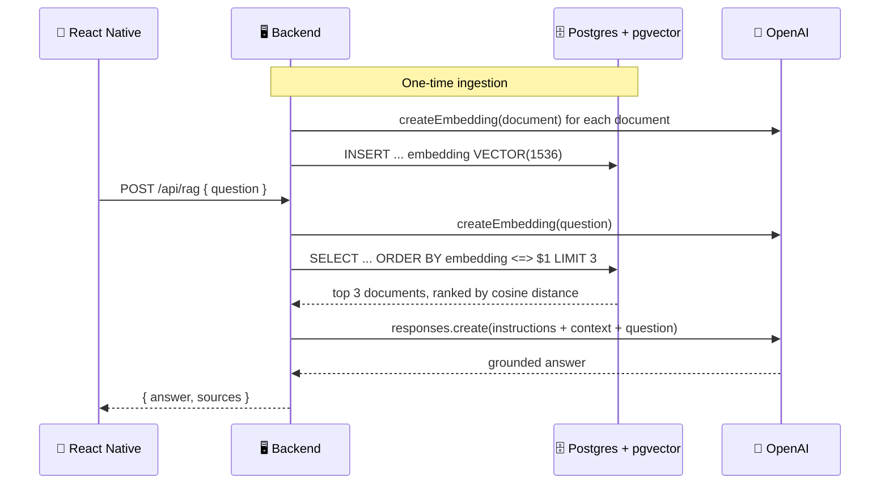

# 🗄️ Production-Style RAG

### Experiment 04 — Part 3: RAG with PostgreSQL + pgvector


Part 2 proved the RAG pipeline — retrieve, then generate. Part 3 replaces the part that doesn't survive a server restart: the in-memory embedding index becomes a real database.

Documents and their embeddings are now persisted in **PostgreSQL** using the **pgvector** extension, and similarity search runs as an actual SQL query instead of a hand-written cosine-similarity loop in JavaScript.

---

## 📑 Table of Contents

- [Core Concept](#-core-concept)
- [What We Build](#-what-we-build)
- [How It Works](#-how-it-works)
- [API](#-api)
- [Project Structure](#-project-structure)
- [Database Setup](#-database-setup)
- [Backend Setup](#-backend-setup)
- [Test the Backend](#-test-the-backend)
- [Run the Mobile Application](#-run-the-mobile-application)
- [Security](#-security)
- [What We Learned](#-what-we-learned)
- [About Harihar Code Studio](#-about-harihar-code-studio)

---

## 💡 Core Concept

> **A vector database isn't a different idea from Part 2 — it's the same idea, moved out of process memory.**

Part 2's `search.ts` held embeddings in a plain array and scored them with a `for` loop. That index vanished every time the server restarted, and it couldn't be queried from anywhere else. Part 3 moves the same responsibility into Postgres:

- Embeddings are stored as a native `VECTOR(1536)` column, not a JS array.
- Similarity is computed by pgvector's `<=>` cosine-distance operator, in SQL.
- The index survives restarts and can be queried, backed up, and scaled like any other table.

---

## 🏗 What We Build

| Part | Stack |
| --- | --- |
| 📱 **Mobile app** | React Native / Expo — standalone app, separate from Parts 1 & 2 |
| 🖥 **Backend** | Node.js / TypeScript (plain `http`) + **PostgreSQL / pgvector** |

### Backend Responsibilities

1. **`database.ts`** — connects to Postgres, enables the `vector` extension, creates the `documents` table if it doesn't exist.
2. **`ingest.ts`** — embeds each document and upserts it into `documents` (`INSERT ... ON CONFLICT DO UPDATE`), so ingestion is safe to re-run.
3. **`search.ts`** — embeds the query, then asks Postgres to rank documents by cosine distance directly in SQL.
4. **`rag.ts`** — same grounded-generation step as Part 2: retrieve, build context, ask the model to answer using only that context.

### Mobile App

A redesigned, branded chat experience — **HCS Assistant**:

- An animated splash screen (logo, channel name, topic name) that holds long enough to read before landing on the app
- A greeting/home screen with **Featured Topics**, **Popular Questions**, and a "How this works" card that explains the RAG pipeline in plain language
- A chat screen with grounded answers and sources shown as cards, not just raw JSON
- A looping "Subscribe" prompt for recording demos — purely cosmetic, not a real subscription feature

---

## 🔄 How It Works

**Example question:**

> *How long do I have to get my money back?*



> [!NOTE]
> `1 - (embedding <=> $1::vector)` converts pgvector's cosine *distance* into the same 0–1 *similarity* score Part 1 and Part 2 returned, so the mobile app's `% match` display didn't need to change.

---

## 📡 API

| Endpoint | Method | Body | Returns |
| --- | --- | --- | --- |
| `/health` | `GET` | — | Service status + a live DB check (`SELECT 1`) |
| `/api/ingest` | `POST` | — | Embeds and stores every document in `documents.ts` |
| `/api/search` | `POST` | `{ "query": string }` | Query + ranked `{ id, content, similarity }[]` |
| `/api/rag` | `POST` | `{ "question": string }` | Question + generated `answer` + ranked `sources[]` |

**Example response (`/api/rag`)**

```json
{
  "question": "How long do I have to get my money back?",
  "answer": "You can request a refund within 30 days of purchase. [Source 1: doc-1]",
  "sources": [
    {
      "id": "doc-1",
      "content": "Our refund policy allows customers to request a refund within 30 days of purchase.",
      "similarity": 0.61
    }
  ]
}
```

---

## 🗂 Project Structure

```text
experiment-04/part-3/
├── mobile/
│   └── src/
│       ├── api/
│       │   └── rag.ts
│       ├── app/
│       │   ├── _layout.tsx
│       │   └── index.tsx
│       └── components/
│           └── animated-icon.tsx
│
└── server/
    ├── src/
    │   ├── database.ts
    │   ├── documents.ts
    │   ├── embeddings.ts
    │   ├── ingest.ts
    │   ├── rag.ts
    │   ├── search.ts
    │   └── server.ts
    │
    ├── package.json
    └── tsconfig.json
```

---

## 🐘 Database Setup

You need a local PostgreSQL instance with the **pgvector** extension available.

**macOS (Homebrew):**

```bash
brew install postgresql pgvector
brew services start postgresql
createdb experiment04_rag
```

pgvector itself doesn't need a separate install step beyond that on recent Homebrew formulas — the server creates the extension and table automatically on startup:

```sql
CREATE EXTENSION IF NOT EXISTS vector;

CREATE TABLE IF NOT EXISTS documents (
  id TEXT PRIMARY KEY,
  content TEXT NOT NULL,
  embedding VECTOR(1536) NOT NULL,
  created_at TIMESTAMPTZ NOT NULL DEFAULT NOW()
);
```

---

## 🚀 Backend Setup

Navigate to the server:

```bash
cd part-3/server
```

Install dependencies:

```bash
npm install
```

Create a `.env` file:

```env
OPENAI_API_KEY=your_openai_api_key_here
PGHOST=localhost
PGPORT=5432
PGDATABASE=experiment04_rag
PGUSER=your_postgres_user
PORT=3003
```

> Never commit the real `.env` file or an actual API key.

Start the development server:

```bash
npm run dev
```

The server runs on **http://localhost:3003** and creates the `vector` extension and `documents` table on startup.

---

## 🧪 Test the Backend

**Health check** (also confirms the database connection)

```bash
curl http://localhost:3003/health
```

**Ingest the knowledge base** (run once before searching)

```bash
curl -X POST http://localhost:3003/api/ingest
```

**Ask a question**

```bash
curl -X POST http://localhost:3003/api/rag \
  -H "Content-Type: application/json" \
  -d '{"question":"How long do I have to get my money back?"}' | jq
```

---

## 📱 Run the Mobile Application

Navigate to the mobile application:

```bash
cd mobile
```

Install dependencies:

```bash
npm install
```

Start Expo:

```bash
npx expo start
```

> [!IMPORTANT]
> The app calls the API at `http://localhost:3003` (see `src/api/rag.ts`). On a physical device or simulator that can't reach `localhost`, update `API_URL` to your machine's LAN IP address.

---

## 🔐 Security

> [!WARNING]
> - The OpenAI API key and database credentials belong on the **backend** only.
> - The `.env` file should **never** be committed to Git.
> - The Postgres connection has no password/SSL configuration — fine for local trust-auth development, but not something to point at a hosted database as-is.
> - CORS is left open (`*`) for local development only — restrict it before shipping this anywhere real.
> - The model is instructed to answer only from retrieved context, but instructions are not a hard guarantee — validate critical outputs before relying on them in production.

---

## 📚 What We Learned

- [x] Storing embeddings in Postgres with the `vector` column type
- [x] Running cosine-similarity search as SQL (`<=>`), not application code
- [x] Idempotent ingestion with `INSERT ... ON CONFLICT DO UPDATE`
- [x] Why a vector database survives restarts where an in-memory index doesn't
- [x] Building a third, independent server + mobile app for a new experiment stage
- [x] Designing a more complete mobile experience: splash screen, greeting state, and grounded chat

---

## ✅ Experiment Status

**Experiment 04 — Part 3: Completed**

### ⏭ Next

This still runs a single Postgres instance with no index on the `embedding` column — fine for four documents, not for scale. A further step would add an IVFFlat/HNSW index, connection pooling limits, and move ingestion off the request path entirely.

Part 4 takes a different next step first: this pipeline still has no safeguard against confidently answering questions the knowledge base can't actually support. See [`part-4/README.md`](../part-4/README.md).

---

## 🎓 About Harihar Code Studio

**Harihar Code Studio** focuses on practical software engineering tutorials covering:

`React Native` · `Mobile Engineering` · `Artificial Intelligence` · `LLM Integrations` · `AI Architecture` · `Developer Tools` · `Production Engineering`

The goal is to understand not only **how** to implement a feature, but also the **architecture and engineering decisions** behind it.
