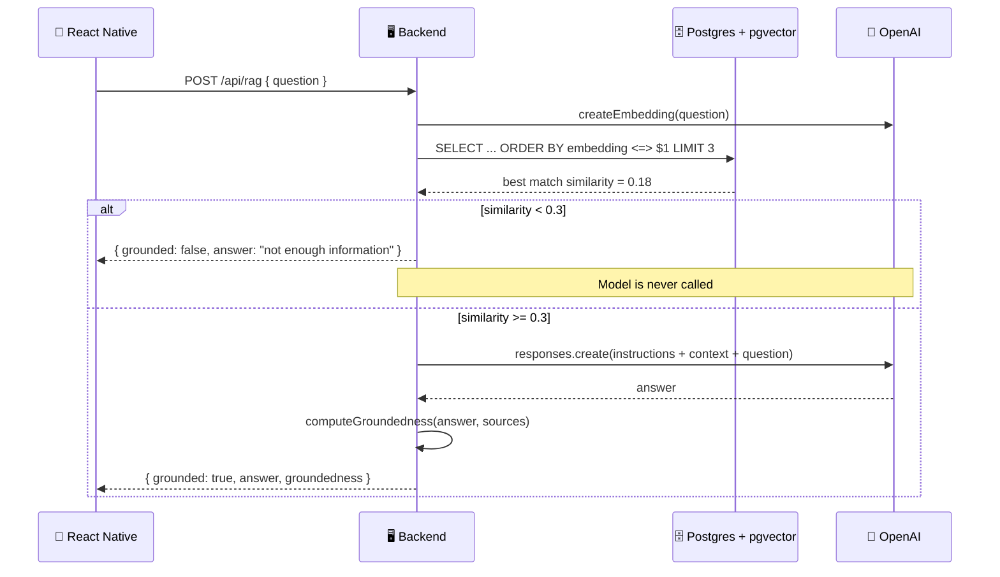

# 🛡️ Hallucination & Grounded Answers

### Experiment 04 — Part 4: Confidence Gates & Groundedness Scoring


Parts 1 through 3 taught this app how to answer. Part 4 teaches it when **not** to.

RAG reduces hallucination, but it doesn't eliminate it — retrieval always returns *something*, even when nothing relevant exists. This part adds two independent safeguards: a **similarity threshold** that refuses to even call the model when retrieval is weak, and a **groundedness score** that checks, after generation, how much of the answer is actually supported by the retrieved documents.

---

## 📑 Table of Contents

- [Core Concept](#-core-concept)
- [What We Build](#-what-we-build)
- [How It Works](#-how-it-works)
- [API](#-api)
- [Project Structure](#-project-structure)
- [Backend Setup](#-backend-setup)
- [Test the Backend](#-test-the-backend)
- [Run the Mobile Application](#-run-the-mobile-application)
- [Security](#-security)
- [What We Learned](#-what-we-learned)
- [About Harihar Code Studio](#-about-harihar-code-studio)

---

## 💡 Core Concept

> **A single safeguard isn't enough. One check belongs before generation, one belongs after.**

| Check | When | Catches |
| --- | --- | --- |
| **Similarity threshold** | Before calling the LLM | "We have no relevant documents for this question" — refuse outright, no model call, no cost |
| **Groundedness score** | After the LLM responds | "We had relevant documents, but the model still drifted beyond them" |

Neither check is a second AI model. Both are cheap, deterministic, and run in milliseconds — this is about engineering discipline around the LLM call, not a smarter model.

---

## 🏗 What We Build

| Part | Stack |
| --- | --- |
| 📱 **Mobile app** | React Native / Expo — standalone app, separate from Parts 1–3 |
| 🖥 **Backend** | Node.js / TypeScript + PostgreSQL / pgvector (same database as Part 3) |

### Backend Responsibilities

1. **`rag.ts`** — before generating, checks the top retrieval similarity against `SIMILARITY_THRESHOLD`. Below it, returns a refusal without ever calling the model.
2. **`groundedness.ts`** — after generating, tokenizes the answer and the retrieved sources, and scores what fraction of the answer's meaningful words are actually supported by the context.
3. **`ungrounded.ts`** — a deliberately unsafe control path: answers with no retrieved context and is instructed to never refuse, used only to demonstrate hallucination side by side with the grounded path.
4. **`server.ts`** — exposes `/api/rag` (grounded, gated, scored) and `/api/compare` (runs grounded + ungrounded in parallel for comparison).

### Mobile App

Builds on Part 3's **HCS Assistant** chat experience with:

- A **confidence badge** on every answer — either `✓ 92% grounded` or `⚠ Not enough information`
- A **"Test the guardrails"** section on the home screen — questions written to intentionally miss the knowledge base, so the refusal path is one tap away
- A **Compare with / without RAG** toggle — when on, every question renders two answers stacked: the ungrounded one (red, fabricated) next to the grounded one (teal, sourced)

---

## 🔄 How It Works

**Example: a question the knowledge base doesn't cover**

> *Do you offer international shipping?*



> [!IMPORTANT]
> `SIMILARITY_THRESHOLD = 0.3` was tuned against this specific four-document knowledge base — a genuinely relevant match here scores roughly 0.5–0.6, an irrelevant one scores well under 0.3. A different document set needs its own threshold.

---

## 📡 API

| Endpoint | Method | Body | Returns |
| --- | --- | --- | --- |
| `/health` | `GET` | — | Service status + live DB check |
| `/api/ingest` | `POST` | — | Embeds and stores every document in `documents.ts` |
| `/api/search` | `POST` | `{ "query": string }` | Query + ranked `{ id, content, similarity }[]` |
| `/api/rag` | `POST` | `{ "question": string }` | Grounded answer + `confidence`, `groundedness`, `grounded`, `sources[]` |
| `/api/compare` | `POST` | `{ "question": string }` | `rag` (grounded) and `noRag` (ungrounded) answers, side by side |

**Example response (`/api/rag`, in scope)**

```json
{
  "question": "How long do I have to get my money back?",
  "answer": "You can request a refund within 30 days of purchase. [Source 1: doc-1]",
  "grounded": true,
  "confidence": 0.61,
  "groundedness": 0.85,
  "sources": [
    { "id": "doc-1", "content": "Our refund policy allows customers to request a refund within 30 days of purchase.", "similarity": 0.61 }
  ]
}
```

**Example response (`/api/rag`, out of scope — the gate firing)**

```json
{
  "question": "Do you offer international shipping?",
  "answer": "I don't have enough information in the knowledge base to answer that confidently.",
  "grounded": false,
  "confidence": 0.18,
  "groundedness": 0,
  "sources": []
}
```

---

## 🗂 Project Structure

```text
experiment-04/part-4/
├── mobile/
│   └── src/
│       ├── api/
│       │   └── rag.ts
│       ├── app/
│       │   ├── _layout.tsx
│       │   └── index.tsx
│       └── components/
│           └── animated-icon.tsx
│
└── server/
    ├── src/
    │   ├── database.ts
    │   ├── documents.ts
    │   ├── embeddings.ts
    │   ├── groundedness.ts
    │   ├── ingest.ts
    │   ├── rag.ts
    │   ├── search.ts
    │   ├── server.ts
    │   └── ungrounded.ts
    │
    ├── package.json
    └── tsconfig.json
```

---

## 🚀 Backend Setup

This reuses Part 3's PostgreSQL database — if you already ran Part 3, there's nothing new to install.

Navigate to the server:

```bash
cd part-4/server
```

Install dependencies:

```bash
npm install
```

Create a `.env` file:

```env
OPENAI_API_KEY=your_openai_api_key_here
PGHOST=localhost
PGPORT=5432
PGDATABASE=experiment04_rag
PGUSER=your_postgres_user
PORT=3004
```

> Never commit the real `.env` file or an actual API key.

Start the development server:

```bash
npm run dev
```

The server runs on **http://localhost:3004**.

---

## 🧪 Test the Backend

**Health check**

```bash
curl http://localhost:3004/health
```

**In-scope question** — should answer normally with a high groundedness score

```bash
curl -X POST http://localhost:3004/api/rag \
  -H "Content-Type: application/json" \
  -d '{"question":"How long do I have to request a refund?"}' | jq
```

**Out-of-scope question** — should trigger the threshold gate (`grounded: false`)

```bash
curl -X POST http://localhost:3004/api/rag \
  -H "Content-Type: application/json" \
  -d '{"question":"Do you offer international shipping?"}' | jq
```

**Side-by-side comparison** — see the hallucinated answer next to the grounded one

```bash
curl -X POST http://localhost:3004/api/compare \
  -H "Content-Type: application/json" \
  -d '{"question":"Do you offer international shipping?"}' | jq
```

---

## 📱 Run the Mobile Application

Navigate to the mobile application:

```bash
cd mobile
```

Install dependencies:

```bash
npm install
```

Start Expo:

```bash
npx expo start
```

> [!IMPORTANT]
> The app calls the API at `http://localhost:3004` (see `src/api/rag.ts`). On a physical device or simulator that can't reach `localhost`, update `API_URL` to your machine's LAN IP address.

---

## 🔐 Security

> [!WARNING]
> - The OpenAI API key and database credentials belong on the **backend** only.
> - The `.env` file should **never** be committed to Git.
> - `/api/compare` and the ungrounded path exist for demonstration only — never expose an intentionally unsafe answer path to real users.
> - The groundedness score is a lexical-overlap heuristic, not a guarantee — a paraphrase can score lower than it deserves, and it doesn't verify factual correctness, only word overlap with the sources.
> - CORS is left open (`*`) for local development only — restrict it before shipping this anywhere real.

---

## 📚 What We Learned

- [x] Why RAG reduces hallucination but doesn't eliminate it
- [x] Gating generation on a retrieval-confidence threshold, before the model is ever called
- [x] Scoring groundedness after generation with a cheap lexical-overlap heuristic
- [x] Why one safeguard isn't enough — pre-generation and post-generation checks catch different failures
- [x] Building a deliberately ungrounded path to demonstrate the failure mode, not just describe it
- [x] Surfacing confidence to the end user instead of hiding it

---

## ✅ Experiment Status

**Experiment 04 — Part 4: Completed**

### ⏭ Next

The groundedness score here is a heuristic, not a judgment call — it can't tell a well-grounded paraphrase from a genuine drift. A further step would replace it with an LLM-as-judge: a second, cheap model call that directly asks "is this answer supported by this context," trading latency and cost for accuracy.

---

## 🎓 About Harihar Code Studio

**Harihar Code Studio** focuses on practical software engineering tutorials covering:

`React Native` · `Mobile Engineering` · `Artificial Intelligence` · `LLM Integrations` · `AI Architecture` · `Developer Tools` · `Production Engineering`

The goal is to understand not only **how** to implement a feature, but also the **architecture and engineering decisions** behind it.
