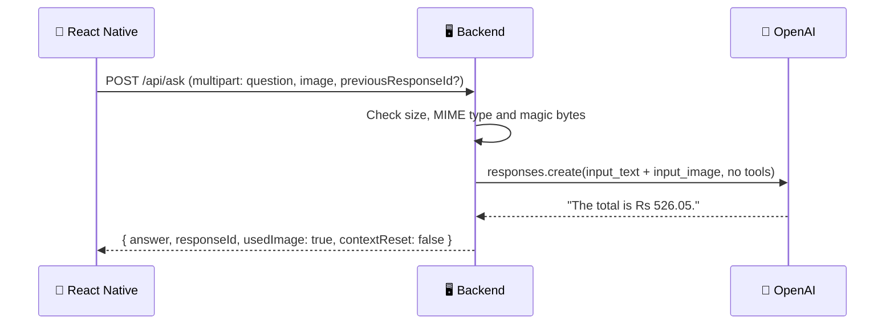

# 👁️ Multimodal AI

### Experiment 05: Ask Questions About Images


Every experiment so far worked with text only. Experiment 05 lets the model **see**.

The user attaches a photo of a receipt, document or object, asks a question about it, and gets an answer read straight from the image. Without an image, the same assistant answers normal questions and can search the web for live information.

---

## 📑 Table of Contents

- [Core Concept](#-core-concept)
- [What We Build](#-what-we-build)
- [How It Works](#-how-it-works)
- [API](#-api)
- [Project Structure](#-project-structure)
- [Requirements](#-requirements)
- [Backend Setup](#-backend-setup)
- [Test the Backend](#-test-the-backend)
- [Run the Mobile Application](#-run-the-mobile-application)
- [Security](#-security)
- [What We Learned](#-what-we-learned)
- [About Harihar Code Studio](#-about-harihar-code-studio)

---

## 💡 Core Concept

> **An image is just another input. Send it in the same message as the question.**

| Input | What the model gets | Tools |
| --- | --- | --- |
| **Question only** | `input_text` | Web search on, for live answers (weather, news, prices) |
| **Image + question** | `input_text` + `input_image` (base64 data URL) | Web search off, so the answer comes only from the image |

Turning search off when an image is attached is deliberate: a receipt question should be answered from the receipt, not from the internet.

---

## 🏗 What We Build

| Part | Stack |
| --- | --- |
| 📱 **Mobile app** | React Native / Expo, with the image picker and camera |
| 🖥 **Backend** | Node.js / TypeScript, Express + Multer, OpenAI Responses API |

### Backend Responsibilities

1. **Upload handling:** Multer keeps the image in memory with an 8 MB limit and one file per request.
2. **Validation:** the declared MIME type must be JPEG, PNG or WEBP, and the file's first bytes (its "magic number") must match it. HEIC is rejected with a clear message.
3. **Conversation memory:** `previousResponseId` links follow-up questions to the earlier answer. If that id has expired, the server retries as a fresh conversation and returns `contextReset: true`.
4. **Friendly errors:** OpenAI errors (bad key, rate limit, timeout, unreadable image) are turned into short messages the app can show.

### Mobile App

- **HCS Assistant** chat screen with a welcome screen, quick prompts and a typing indicator
- **+ button** to choose an image from the library or take a photo
- Client-side checks for file type and size before uploading
- **Retry** on a failed answer and **New** to start a fresh conversation

---

## 🔄 How It Works

**Example: "What is the total?" with a receipt attached**



---

## 📡 API

| Endpoint | Method | Body | Returns |
| --- | --- | --- | --- |
| `/health` | `GET` | n/a | Service status + model name |
| `/api/ask` | `POST` | `multipart/form-data`: `question`, `image`, `previousResponseId` (all optional, but a question or an image is required) | `answer`, `responseId`, `usedImage`, `contextReset` |

**Example response**

```json
{
  "answer": "The total is Rs 526.05.\n\nPlease double-check the amount before relying on it.",
  "responseId": "resp_...",
  "usedImage": true,
  "contextReset": false
}
```

| Status | When |
| --- | --- |
| `400` | No question and no image, or the question is over 1000 characters |
| `413` | Image is larger than 8 MB |
| `415` | Not a JPEG, PNG or WEBP, HEIC, or the file contents don't match the type |
| `422` | OpenAI couldn't process the image |
| `502` / `503` / `504` | Bad API key, rate limit, or timeout |

---

## 🗂 Project Structure

```text
experiment-05/
├── mobile/
│   └── src/
│       ├── api/
│       │   └── assistant.ts
│       ├── app/
│       │   ├── _layout.tsx
│       │   └── index.tsx
│       ├── components/chat/
│       │   ├── chat-intro.tsx
│       │   ├── composer.tsx
│       │   ├── empty-state.tsx
│       │   ├── message-bubble.tsx
│       │   └── typing-indicator.tsx
│       └── constants/
│           └── brand.ts
│
└── server/
    ├── src/
    │   └── server.ts
    ├── .env.example
    ├── receipt.png
    ├── package.json
    └── tsconfig.json
```

---

## 🧰 Requirements

- **Node.js 22.13 or newer.** Older versions fail with errors from Expo and TypeScript. Check with `node -v`.
- An **OpenAI API key** with access to the model set in `OPENAI_MODEL`.
- **Xcode** (iOS Simulator), **Android Studio**, or the **Expo Go** app on a phone.

---

## 🚀 Backend Setup

Navigate to the server:

```bash
cd experiment-05/server
```

Install dependencies:

```bash
npm install
```

Create a `.env` file from the example and add your key:

```bash
cp .env.example .env
```

```env
OPENAI_API_KEY=your_openai_api_key_here
OPENAI_MODEL=gpt-5.6
PORT=3005
```

> Never commit the real `.env` file or an actual API key.

Start the development server:

```bash
npm run dev
```

The server runs on **http://localhost:3005**.

---

## 🧪 Test the Backend

Run these from the `server` folder, because `@receipt.png` is read from the current folder.

**Health check**

```bash
curl http://localhost:3005/health
```

**Question about an image** (uses the sample receipt in this folder)

```bash
curl -F "question=What is the total?" \
  -F "image=@receipt.png;type=image/png" \
  http://localhost:3005/api/ask
```

**Follow-up question** (paste the `responseId` from the previous answer)

```bash
curl -F "question=How much was the coffee?" \
  -F "previousResponseId=resp_PASTE_ID_HERE" \
  http://localhost:3005/api/ask
```

**Text-only question** (uses web search)

```bash
curl -F "question=What is multimodal AI?" http://localhost:3005/api/ask
```

> [!TIP]
> `curl: (26) Failed to open/read local data` means curl couldn't find the image file. Check the path after `@`. For a JPEG, use `type=image/jpeg`.

---

## 📱 Run the Mobile Application

Navigate to the mobile application:

```bash
cd experiment-05/mobile
```

Install dependencies:

```bash
npm install
```

Start Expo:

```bash
npx expo start
```

> [!IMPORTANT]
> The app calls the API at `http://localhost:3005`, which only works in the **iOS Simulator**. On a physical phone or the Android Emulator, start Expo with your computer's LAN IP address:
>
> ```bash
> EXPO_PUBLIC_API_URL=http://192.168.1.10:3005 npx expo start
> ```
>
> The phone and the computer must be on the same Wi-Fi network.

The iOS Simulator has no camera, so use **Choose from library** there. Drag an image onto the simulator window to add it to Photos.

---

## 🔐 Security

> [!WARNING]
> - The OpenAI API key belongs on the **backend** only. The app never sees it.
> - The `.env` file should **never** be committed to Git.
> - The MIME type sent by the client can't be trusted, so the server also checks the file's magic bytes.
> - Images are kept in memory only and are never written to disk.
> - AI can misread amounts and numbers. Always double-check important values.
> - CORS is left open (`*`) for local development only. Restrict it before shipping this anywhere real.

---

## 📚 What We Learned

- [x] Sending an image and a question together in one Responses API request
- [x] Uploading images from React Native with `multipart/form-data`
- [x] Validating uploads on the server: size limits, MIME types and magic bytes
- [x] Grounding answers in the image by turning web search off when an image is attached
- [x] Keeping a conversation going with `previous_response_id`, and recovering when it expires
- [x] Turning provider errors into clear messages for the user

---

## ✅ Experiment Status

**Experiment 05: Completed**

### ⏭ Next

Experiment 06 moves from images to **voice**: speaking a question and hearing the answer.

---

## 🎓 About Harihar Code Studio

**Harihar Code Studio** focuses on practical software engineering tutorials covering:

`React Native` · `Mobile Engineering` · `Artificial Intelligence` · `LLM Integrations` · `AI Architecture` · `Developer Tools` · `Production Engineering`

The goal is to understand not only **how** to implement a feature, but also the **architecture and engineering decisions** behind it.
