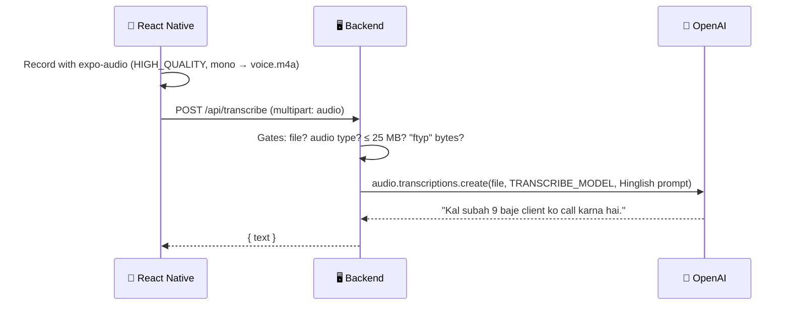

# 🎙️ Voice Assistant — Speech-to-Text

### Experiment 06 · Part 1: Give the App Ears


Most people type about 40 words a minute but speak about 150. Experiment 05 let the app **see**; Experiment 06 lets it **hear**.

The user taps the mic and speaks in English, Hindi or Hinglish. The app records an `.m4a` file, sends it to our server, and shows the text it gets back. The OpenAI API key stays on the server.

This is Part 1 of the five-part [Voice Productivity Assistant](../README.md) series.

---

## 📑 Table of Contents

- [Core Concept](#-core-concept)
- [Series Roadmap](#-series-roadmap)
- [What We Build](#-what-we-build)
- [How It Works](#-how-it-works)
- [API](#-api)
- [Project Structure](#-project-structure)
- [Requirements](#-requirements)
- [Backend Setup](#-backend-setup)
- [Test the Backend](#-test-the-backend)
- [Run the Mobile Application](#-run-the-mobile-application)
- [Security](#-security)
- [What We Learned](#-what-we-learned)
- [About Harihar Code Studio](#-about-harihar-code-studio)

---

## 💡 Core Concept

> **Speech-to-Text (STT), or ASR (Automatic Speech Recognition), turns spoken audio into written text.**

```text
voice → mic → samples (~16,000 / sec) → spectrogram → AI model → text
```

A spectrogram is a "photo" of sound: time on one axis, frequency on the other, and colour for loudness. The model reads it the way the Experiment 05 model read image tokens, and it uses context too, so it can tell "two tickets to Pune" from "too" and handle Hinglish such as "Kal meeting cancel hai".

Part 1 is **recorded, not streamed**: record → stop → send the whole file once. Live streaming comes in Part 5.

---

## 🗺 Series Roadmap

| Part | Topic | What the app gains |
| --- | --- | --- |
| **P1** | **Speech-to-Text** | **Hears and writes (this folder)** |
| P2 | AI Assistant | Understands what you want and replies |
| P3 | Text-to-Speech | Speaks the reply |
| P4 | Productivity Tools | Adds and lists tasks |
| P5 | Real-Time Voice | Live conversation, like a phone call |

---

## 🏗 What We Build

| Part | Stack |
| --- | --- |
| 📱 **Mobile app** | React Native / Expo, `expo-audio` for recording, `expo-file-system` for upload |
| 🖥 **Backend** | Node.js / TypeScript, Express + Multer, OpenAI Audio API |

### Backend: four gates

Every request passes four checks before OpenAI is called:

| Gate | Check | Fails with |
| --- | --- | --- |
| 1 | Was a file sent in the `audio` field? | `400` No audio file. |
| 2 | Is the MIME type `audio/*`? | `415` Only audio files are allowed. |
| 3 | Is it 25 MB or less (OpenAI's limit)? | `413` File too big (max 25 MB). |
| 4 | Do the file's first bytes say `ftyp` (a real m4a)? | `415` Only audio files are allowed. |

The OpenAI call also sends a short `prompt`. Spoken Hindi and Urdu sound the same, so without it the model may write Hindi in Devanagari or even Urdu script; the prompt keeps the text in Roman Hinglish with numbers as digits ("Kal subah 9 baje…").

> [!NOTE]
> We use `gpt-4o-transcribe`. In testing, the smaller `gpt-4o-mini-transcribe` ignored the prompt on longer Hindi sentences and wrote them in Devanagari; `gpt-4o-transcribe` followed it every time.

Multer keeps the file in memory (it's only forwarded, never saved). Any other failure returns `500` "Transcription failed. Try again." instead of crashing the server.

### Mobile app: five states

```text
idle ──tap──▶ recording ──stop──▶ uploading ──200──▶ done
  ▲                                   │
  └────────── Try again ◀── error ◀───┘ fail
```

- **Idle:** mic ready
- **Recording:** red button, running timer
- **Uploading:** file on its way to the server
- **Done:** "Aapne bola" card with the text
- **Error:** red card with **Try again** (re-sends the same recording) or **Open Settings** if mic permission was denied

---

## 🔄 How It Works

**Example: "Kal subah 9 baje client ko call karna hai."**



---

## 📡 API

| Endpoint | Method | Body | Returns |
| --- | --- | --- | --- |
| `/health` | `GET` | n/a | Service status + model name |
| `/api/transcribe` | `POST` | `multipart/form-data` with one file in the `audio` field (m4a, max 25 MB) | `{ "text": "..." }` |

| Status | When |
| --- | --- |
| `400` | No file in the `audio` field |
| `413` | File is larger than 25 MB |
| `415` | Not an audio MIME type, or the bytes aren't an m4a file |
| `500` | Transcription failed (bad key, network, OpenAI error) |

---

## 🗂 Project Structure

```text
experiment-06/
├── README.md                 ← series overview
└── part-1/
    ├── README.md             ← this file
    ├── server/
    │   ├── src/index.ts      ← Express + /api/transcribe
    │   ├── .env              ← 🔒 secret (never committed)
    │   ├── .env.example      ← template
    │   ├── sample.m4a        ← test audio for curl
    │   └── package.json
    └── mobile/
        ├── app/
        │   ├── _layout.tsx
        │   └── (tabs)/index.tsx  ← record screen
        ├── src/
        │   ├── api/voice.ts      ← upload helper
        │   ├── components/voice/
        │   │   ├── mic-button.tsx
        │   │   └── result-card.tsx
        │   └── constants/brand.ts
        ├── .env.example      ← server URL template (copy to .env.local)
        ├── app.json          ← mic permission
        └── package.json
```

---

## 🧰 Requirements

- **Node.js 22.13 or newer.** Check with `node -v`.
- An **OpenAI API key** with access to the model set in `TRANSCRIBE_MODEL`.
- **Android Studio** (for `adb` and the Android build tools) and a **real Android phone** with USB or wireless debugging on.
- The phone and the computer on the **same Wi-Fi network**.

> [!WARNING]
> Test voice features on a **real phone**. While building this, the iOS Simulator received pure silence from the Mac's microphone, and the Android Emulator's mic cut out after about 3 seconds. The app and server were fine; the real phone worked first time.

---

## 🚀 Backend Setup

From the repository root:

```bash
cd ai/experiment-06/part-1/server
npm install
cp .env.example .env
```

Add your key to `.env`:

```env
OPENAI_API_KEY=your-key-here
TRANSCRIBE_MODEL=gpt-4o-transcribe
PORT=3006
```

The model name lives in `.env`, so switching models (for example to the cheaper `gpt-4o-mini-transcribe`) needs no code change.

> Never commit the real `.env` file or an actual API key.

Start the server:

```bash
npm run dev
```

You should see `Server on http://localhost:3006 (model: gpt-4o-transcribe)`. The server listens on `0.0.0.0`, so a phone on the same Wi-Fi can reach it too.

### Packages used

```bash
# server
npm i express multer openai cors dotenv
npm i -D typescript tsx @types/express @types/multer @types/cors

# mobile
npx expo install expo-audio expo-file-system
```

---

## 🧪 Test the Backend

Run these from the `server` folder, because `@sample.m4a` is read from the current folder.

**1 · Happy path (200)**

```bash
curl -s -F "audio=@sample.m4a;type=audio/m4a" http://localhost:3006/api/transcribe
# {"text":"Hello, this is my first voice note."}
```

**2 · No file (400)**

```bash
curl -s -X POST http://localhost:3006/api/transcribe
# {"error":"No audio file."}
```

**3 · Wrong type (415)**: send this README instead of audio

```bash
curl -s -F "audio=@../README.md;type=text/markdown" http://localhost:3006/api/transcribe
# {"error":"Only audio files are allowed."}
```

**4 · Fake audio (415)**: the README relabelled as audio; only the magic-bytes check catches it

```bash
curl -s -F "audio=@../README.md;type=audio/m4a" http://localhost:3006/api/transcribe
# {"error":"Only audio files are allowed."}
```

**5 · Too big (413)**

```bash
head -c 26214500 /dev/zero > big.m4a
curl -s -F "audio=@big.m4a;type=audio/m4a" http://localhost:3006/api/transcribe
rm big.m4a
# {"error":"File too big (max 25 MB)."}
```

Add `-w "  → %{http_code}\n"` to any command to print the status code after the JSON.

> [!TIP]
> To make your own `sample.m4a` on a Mac:
> `say -o sample.m4a --file-format=m4af --data-format=aac "Hello, this is my first voice note."`

---

## 📱 Run the Mobile Application

From the repository root:

```bash
cd ai/experiment-06/part-1/mobile
npm install
```

**1 · Point the app at your computer.** On a phone, `localhost` means the phone itself, so the app needs your computer's Wi-Fi IP:

```bash
ipconfig getifaddr en0          # macOS; e.g. 192.168.29.165
cp .env.example .env.local      # then set the IP in .env.local
```

```env
EXPO_PUBLIC_API_URL=http://192.168.29.165:3006
```

`.env.local` is gitignored. If your router gives the computer a new IP, update it and restart Expo with `npx expo start -c`.

**2 · Build and install on the phone.** Connect the phone (USB or wireless debugging), check it shows in `adb devices`, then:

```bash
npx expo run:android --device
```

`expo-audio` adds the `RECORD_AUDIO` permission (and the iOS permission text) from `app.json`, so the app needs a development build, not Expo Go. After the first install, `npx expo start` and pressing `a` is enough.

> [!TIP]
> - To show the permission popup again: `adb shell pm revoke com.hariharharry.mobile android.permission.RECORD_AUDIO`
> - To mirror the phone for a screen recording: `brew install scrcpy` then `scrcpy --show-touches --stay-awake --no-audio`
> - If the build fails with `No space left on device`, free some disk space (Gradle needs several GB).

---

## 🔐 Security

> [!WARNING]
> - The OpenAI API key belongs on the **server** only. Anyone can unpack a mobile app and pull a key out of it.
> - The `.env` file is in `.gitignore` and should **never** be committed or shown on screen.
> - The MIME type sent by the client can't be trusted, so the server also checks the file's magic bytes.
> - Audio is kept in memory only and is never written to disk.
> - CORS is left open (`*`) for local development only. Restrict it before shipping.

---

## 📚 What We Learned

- [x] How Speech-to-Text works: sound → samples → spectrogram → model → text
- [x] Recording mono `.m4a` audio with `expo-audio` and asking for mic permission
- [x] Uploading a file from React Native with `multipart/form-data` and `new File(uri)`
- [x] Guarding an upload endpoint: 400 · 415 · 413 and magic bytes
- [x] Calling the OpenAI Audio API with `toFile` in five lines
- [x] Steering Hinglish output with a transcription `prompt`, and why the model choice matters
- [x] Testing the server with curl before building the app
- [x] Handling the edge cases: permission denied and server down
- [x] Reaching a server on your computer from a real phone over Wi-Fi
- [x] Testing voice features on a real device instead of a simulator

---

## ✅ Experiment Status

**Experiment 06 · Part 1: Completed**

### ⏭ Next

**Part 2 — AI Assistant:** the transcribed text goes to an LLM, which works out whether you want a reminder or a task and replies.

---

## 🎓 About Harihar Code Studio

**Harihar Code Studio** focuses on practical software engineering tutorials covering:

`React Native` · `Mobile Engineering` · `Artificial Intelligence` · `LLM Integrations` · `AI Architecture` · `Developer Tools` · `Production Engineering`

The goal is to understand not only **how** to implement a feature, but also the **architecture and engineering decisions** behind it.
