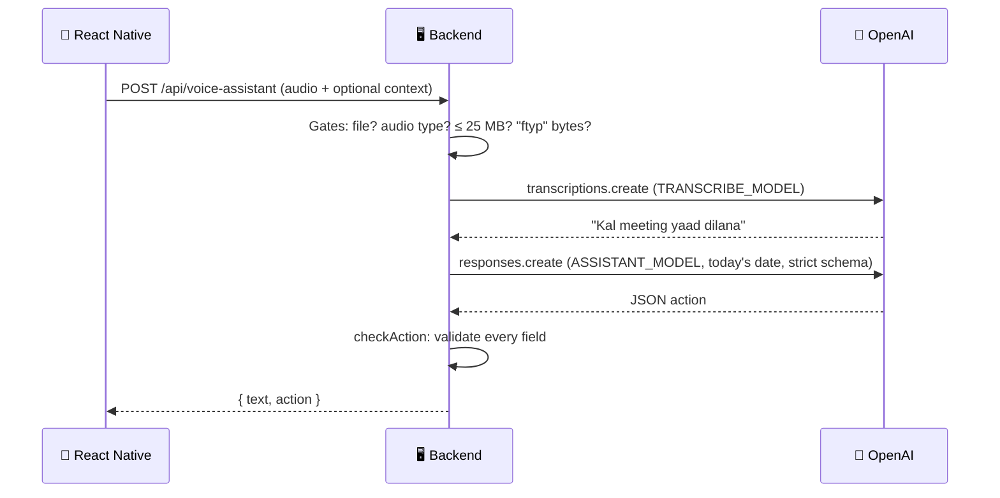

# 🧠 Voice Assistant — AI Assistant

### Experiment 06 · Part 2: Give the App a Brain


Part 1 gave the app **ears**: it turned your voice into text. Part 2 gives it a **brain**: it works out what that text means.

You say "Kal subah 9 baje client ko call karna hai" and the app shows a **REMINDER** card: Kal · 9:00 AM · client. No form, no date picker, no typing. If you leave something out ("Kal meeting yaad dilana"), the app doesn't guess a time. It asks you.

This is Part 2 of the five-part [Voice Productivity Assistant](../README.md) series.

---

## 📑 Table of Contents

- [Core Concept](#-core-concept)
- [Series Roadmap](#-series-roadmap)
- [Three Attempts, Three Lessons](#-three-attempts-three-lessons)
- [The Final Version: Three Fixes](#-the-final-version-three-fixes)
- [How It Works](#-how-it-works)
- [API](#-api)
- [Project Structure](#-project-structure)
- [Requirements](#-requirements)
- [Backend Setup](#-backend-setup)
- [Run the Labs](#-run-the-labs)
- [Test the Backend](#-test-the-backend)
- [Run the Mobile Application](#-run-the-mobile-application)
- [Troubleshooting](#-troubleshooting)
- [Security](#-security)
- [What We Learned](#-what-we-learned)
- [About Harihar Code Studio](#-about-harihar-code-studio)

---

## 💡 Core Concept

> **Understanding a sentence means pulling out two things: the intent and the details.**

```text
"Kal subah 9 baje client ko call karna hai"
   intent  → reminder
   details → when: kal, 09:00 · who: client · what: call
```

To a person this takes a second. To the app it's just a long string. Part 2 turns that string into a fixed JSON shape the app can read every time.

---

## 🗺 Series Roadmap

| Part | Topic | What the app gains |
| --- | --- | --- |
| P1 | Speech-to-Text | Hears and writes |
| **P2** | **AI Assistant** | **Understands what you want and replies (this folder)** |
| P3 | Text-to-Speech | Speaks the reply |
| P4 | Productivity Tools | Adds and lists tasks |
| P5 | Real-Time Voice | Live conversation, like a phone call |

---

## 🧪 Three Attempts, Three Lessons

We got to the final version by failing three times. Each attempt is a small script in `server/labs/`.

| Attempt | Idea | Result | Lesson |
| --- | --- | --- | --- |
| 1 · `lab:1` | Rules on words: "yaad" or "baje" → reminder | **2 / 4** | Matching words isn't understanding. "Mujhe **yaad** nahi…" became a reminder, and "bhej**ni**" missed the "bhej**na**" rule. |
| 2 · `lab:2` | Ask the AI in plain words | **~70%** | It understands, but answers with a different paragraph each time. The app can't read a paragraph. |
| 3 · `lab:3` | Give the AI a form (Structured Outputs) | **~90%** | Clean JSON, but the date is wrong (the model has no clock) and the time is made up when you don't say one. |

---

## ✅ The Final Version: Three Fixes

All three live in `server/src/assistant.ts`.

| Fix | Problem | Solution |
| --- | --- | --- |
| 1 · Today's date | The model has no clock, so "kal" can't become a date | `buildInstructions()` starts with today's weekday, date and time in `Asia/Kolkata` (from `nowInIndia()`) |
| 2 · Ask, don't guess | A required `time` field forces the model to invent one | `date` and `time` can be `null`. New fields `needs_clarification` and `question` let the AI ask "Kitne baje yaad dilaun?" |
| 3 · Check everything | Even a strict schema shouldn't be trusted blindly | `checkAction()` validates every field: bad date → `null`, `25:99` → `null`, unknown intent → `other`. A reminder without a time **always** gets a question. |

### The final schema

```ts
{
  intent: "reminder" | "task" | "note" | "question" | "other",
  title: string,
  date: string | null,          // "YYYY-MM-DD", null = user didn't say it
  time: string | null,          // "HH:MM", 24-hour
  people: string[],
  priority: "low" | "normal" | "high",
  needs_clarification: boolean,
  question: string | null,      // "Kitne baje yaad dilaun?"
  reply: string,                // one short Hinglish line
}
```

It is sent with `strict: true`, so every answer has exactly these fields: none missing, none extra.

> [!NOTE]
> The server turns `needs_clarification` into `needsClarification` before it reaches the app, so the app only ever sees checked, camelCase fields.

---

## 🔄 How It Works

**One trip, two jobs.** The app sends the recording once; the server transcribes it (Part 1) and then understands it (Part 2).



### The follow-up loop

```text
"Kal meeting yaad dilana"  ──▶  amber card: "Kitne baje yaad dilaun?"
                                     │  app keeps the sentence as context
"Shaam 5 baje" (+ context) ──▶  REMINDER · Kal · 5:00 PM · meeting
```

### Mobile app: five states

```text
idle ──tap──▶ recording ──stop──▶ working ──200──▶ done ──AI asked?──▶ (tap mic to answer)
  ▲                                   │
  └────────── Try again ◀── error ◀───┘ fail
```

- **Working:** "Sun liya, ab samajh raha hoon."
- **Done:** the "Aapne bola" card from Part 1, plus an **ActionCard**: a coloured label (⏰ reminder, ✅ task, 📝 note, ❓ question), the title, chips for when / who / urgent, and the assistant's reply. If the AI is asking something, the whole card turns **amber**.
- **Error:** the same red card and **Try again** as Part 1.

---

## 📡 API

| Endpoint | Method | Body | Returns |
| --- | --- | --- | --- |
| `/health` | `GET` | n/a | Service status + both model names |
| `/api/transcribe` | `POST` | `multipart/form-data`, `audio` field | `{ "text": "..." }` (Part 1, unchanged) |
| `/api/assistant` | `POST` | JSON `{ "text": "...", "context"?: "..." }` | `{ "text", "action" }`: for curl, no mic needed |
| `/api/voice-assistant` | `POST` | `multipart/form-data`, `audio` field + optional `context` field | `{ "text", "action" }`: what the app calls |

`action` is `null` if the recording was silent.

| Status | When |
| --- | --- |
| `400` | No file · `Text is required.` · `Invalid JSON.` |
| `413` | File larger than 25 MB · text longer than 1000 characters |
| `415` | Not an audio MIME type, or the bytes aren't an m4a file |
| `500` | `Something went wrong. Try again.` (bad key, wrong model name, network, OpenAI error) |

---

## 🗂 Project Structure

```text
experiment-06/
├── README.md                 ← series overview
├── part-1/                   ← Speech-to-Text
└── part-2/
    ├── README.md             ← this file
    ├── server/
    │   ├── labs/
    │   │   ├── 01-keyword.ts     ← attempt 1: rules (no key needed)
    │   │   ├── 02-plain-ai.ts    ← attempt 2: plain AI
    │   │   └── 03-json-v1.ts     ← attempt 3: first form
    │   ├── src/
    │   │   ├── assistant.ts      ← instructions, schema, checkAction, understand
    │   │   └── index.ts          ← Express + the routes
    │   ├── .env.example
    │   ├── sample.m4a
    │   └── package.json
    └── mobile/
        ├── app/(tabs)/index.tsx  ← record screen + follow-up loop
        └── src/
            ├── api/voice.ts      ← askAssistant
            ├── components/
            │   ├── ActionCard.tsx    ← what the AI understood
            │   └── voice/            ← mic button, transcript + error cards
            ├── utils/when.ts     ← "2026-10-25" + "09:00" → "Kal · 9:00 AM"
            └── constants/brand.ts
```

---

## 🧰 Requirements

Same as [Part 1](../part-1/README.md#-requirements), plus:

- An OpenAI model for `ASSISTANT_MODEL` that supports **Structured Outputs** (`json_schema` with `strict: true`).

---

## 🚀 Backend Setup

From the repository root:

```bash
cd ai/experiment-06/part-2/server
npm install
cp .env.example .env
```

`.env` has one new line compared to Part 1:

```env
OPENAI_API_KEY=your-key-here
TRANSCRIBE_MODEL=gpt-4o-transcribe
ASSISTANT_MODEL=gpt-6-luna
PORT=3006
```

As with `TRANSCRIBE_MODEL`, switching the assistant model needs no code change.

> Never commit the real `.env` file or an actual API key.

```bash
npm run dev
# Server on http://localhost:3006 (stt: gpt-4o-transcribe, assistant: gpt-6-luna)
# Today is Saturday, 2026-10-24 (IST)
```

The second line is the date the AI is told. If "kal" comes out a day off, check this line first.

---

## 🔬 Run the Labs

```bash
npm run lab:1   # rules on words: Score 2/4 (no API key needed)
npm run lab:2   # plain AI, run twice: two different paragraphs
npm run lab:3   # first form: clean JSON, but a wrong date and a made-up time
```

---

## 🧪 Test the Backend

Run these with the server on. Add `| npx json` to pretty-print the output.

**1 · Reminder (200)**

```bash
curl -s -X POST http://localhost:3006/api/assistant \
  -H "Content-Type: application/json" \
  -d '{"text":"Kal subah 9 baje client ko call karna hai"}'
# "intent":"reminder","date":"2026-10-25","time":"09:00","people":["client"], ...
```

**2 · Missing time: the AI asks (200)**

```bash
curl -s -X POST http://localhost:3006/api/assistant \
  -H "Content-Type: application/json" \
  -d '{"text":"Kal meeting yaad dilana"}'
# "time":null,"needsClarification":true,"question":"Kitne baje yaad dilaun?"
```

**3 · Answer with context (200)**

```bash
curl -s -X POST http://localhost:3006/api/assistant \
  -H "Content-Type: application/json" \
  -d '{"text":"shaam 5 baje","context":"Kal meeting yaad dilana"}'
# "intent":"reminder","date":"2026-10-25","time":"17:00","needsClarification":false
```

**4 · Empty request (400)**

```bash
curl -s -X POST http://localhost:3006/api/assistant \
  -H "Content-Type: application/json" -d '{}'
# {"error":"Text is required."}
```

**5 · Broken JSON (400)**

```bash
curl -s -X POST http://localhost:3006/api/assistant \
  -H "Content-Type: application/json" -d '{bad'
# {"error":"Invalid JSON."}
```

**6 · Voice, end to end (200)** (from the `server` folder)

```bash
curl -s -F "audio=@sample.m4a;type=audio/m4a" http://localhost:3006/api/voice-assistant
# {"text":"Hello, this is my first voice note.","action":{"intent":"other", ...}}
```

The Part 1 checks (400 no file, 415 wrong type or fake audio, 413 too big) work on `/api/voice-assistant` too. See the [Part 1 tests](../part-1/README.md#-test-the-backend).

---

## 📱 Run the Mobile Application

Same steps as [Part 1](../part-1/README.md#-run-the-mobile-application), from this folder:

```bash
cd ai/experiment-06/part-2/mobile
npm install
cp .env.example .env.local      # set your computer's Wi-Fi IP
npx expo run:android --device
```

Part 2 uses the same app ID as Part 1, so it installs over it on the phone.

**Try these five lines:**

| Say | Expect |
| --- | --- |
| "Kal subah 9 baje client ko call karna hai" | ⏰ REMINDER · Kal · 9:00 AM · client |
| "Rahul ko presentation Friday tak bhejni hai, urgent hai" | ✅ TASK · Fri · Rahul · 🔥 Urgent |
| "Note kar lo, gaadi B2 parking mein slot 45 par hai" | 📝 NOTE, no date |
| "Kal meeting yaad dilana" → then "Shaam 5 baje" | amber "Kitne baje yaad dilaun?" → ⏰ REMINDER · Kal · 5:00 PM |
| "Mujhe yaad nahi ki meeting kab hai" | ❓ QUESTION, **not** a reminder |

---

## 🛠 Troubleshooting

| Symptom | Fix |
| --- | --- |
| `500 Something went wrong` | Read the server terminal. Usually the model name is wrong or the model doesn't support Structured Outputs: change `ASSISTANT_MODEL` and restart. |
| Date is a day off | Check the `Today is …` line in the server log, and the Mac's date and time zone. |
| Every reminder asks for a time | Say the time clearly ("subah 9 baje") and check the "Aapne bola" card. |
| `Can't reach server` | Same as Part 1: same Wi-Fi, IP in `.env.local`, `npx expo start -c`, firewall. |
| Only text, no card | The app is still calling `/api/transcribe`. `index.tsx` should use `askAssistant`. |

---

## 🔐 Security

> [!WARNING]
> - The OpenAI API key stays on the **server**. The app only talks to our backend.
> - The AI's output is **checked** before it reaches the app. A strict schema is a strong promise, not a guarantee.
> - The app only **shows** a card; nothing is saved yet. In Part 4 the user confirms before anything is stored. The AI suggests, the user decides.
> - Text input is capped (1000 characters, 10 KB JSON) and audio is still capped at 25 MB, kept in memory only.
> - CORS is left open (`*`) for local development only. Restrict it before shipping.

---

## 📚 What We Learned

- [x] Writing text down isn't understanding it: understanding = intent + details
- [x] Why keyword rules break (2/4), and why a plain AI paragraph isn't enough
- [x] Structured Outputs: a JSON schema with `strict: true` gives the same shape every time
- [x] The model has no clock: send today's date in the user's time zone
- [x] Nullable fields + `needs_clarification`: ask instead of hallucinating
- [x] Never trust AI output blindly: validate every field on the server
- [x] One request, two jobs: transcribe, then understand
- [x] A follow-up loop that sends the earlier sentence as context
- [x] Turning `2026-10-25` + `09:00` into "Kal · 9:00 AM" for people

---

## ✅ Experiment Status

**Experiment 06 · Part 2: Completed**

### ⏭ Next

**Part 3 — Text-to-Speech:** the assistant stops writing its reply and starts saying it out loud.

---

## 🎓 About Harihar Code Studio

**Harihar Code Studio** focuses on practical software engineering tutorials covering:

`React Native` · `Mobile Engineering` · `Artificial Intelligence` · `LLM Integrations` · `AI Architecture` · `Developer Tools` · `Production Engineering`

The goal is to understand not only **how** to implement a feature, but also the **architecture and engineering decisions** behind it.
