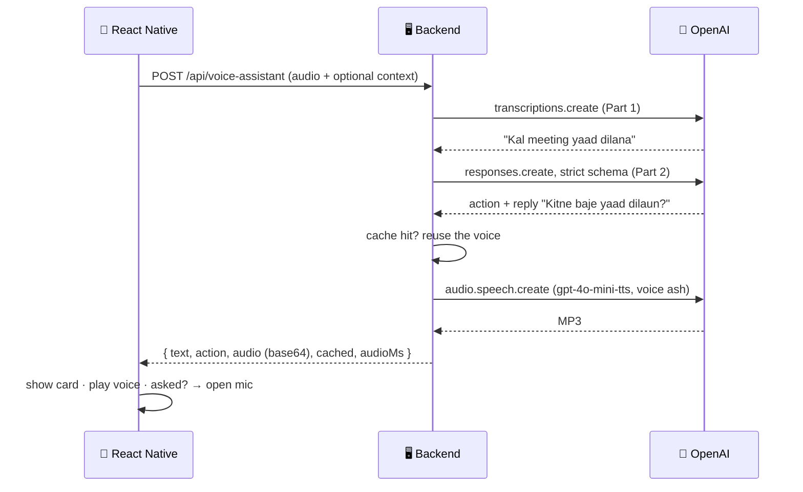

# 🔊 Voice Assistant — Text-to-Speech

### Experiment 06 · Part 3: Give the App a Voice


Part 1 gave the app **ears**. Part 2 gave it a **brain**. Part 3 gives it a **voice**.

Until now the assistant heard you and understood you, but its answer was only text on the screen. That's no use while you're driving. Now the reply is **spoken**, and if the assistant asks a question, the **mic opens by itself** and closes again when you stop talking. One tap, a whole conversation:

```text
You:        "Kal meeting yaad dilana."
Assistant:  🔊 "Kitne baje yaad dilaun?"        ← mic opens by itself
You:        "Shaam 5 baje."                    ← recording stops when you go quiet
Assistant:  🔊 "Theek hai, kal shaam 5 baje meeting yaad dilaunga."
```

This is Part 3 of the five-part [Voice Productivity Assistant](../README.md) series.

---

## 📑 Table of Contents

- [Core Concept](#-core-concept)
- [Series Roadmap](#-series-roadmap)
- [The Answer: Three Parts](#-the-answer-three-parts)
- [How It Works](#-how-it-works)
- [What's New in the Code](#-whats-new-in-the-code)
- [API](#-api)
- [Project Structure](#-project-structure)
- [Requirements](#-requirements)
- [Backend Setup](#-backend-setup)
- [Test the Backend](#-test-the-backend)
- [Run the Mobile Application](#-run-the-mobile-application)
- [Troubleshooting](#-troubleshooting)
- [Security](#-security)
- [What We Learned](#-what-we-learned)
- [About Harihar Code Studio](#-about-harihar-code-studio)

---

## 💡 Core Concept

> **Text-to-Speech (TTS) turns text into spoken audio.**

```text
"Kitne baje yaad dilaun?"  →  gpt-4o-mini-tts (voice: ash)  →  reply.mp3
```

`gpt-4o-mini-tts` can also be told **how** to speak. We ask for a friendly Indian assistant speaking natural Hinglish, slightly quick and relaxed, not like an announcement.

---

## 🗺 Series Roadmap

| Part | Topic | What the app gains |
| --- | --- | --- |
| P1 | Speech-to-Text | Hears and writes |
| P2 | AI Assistant | Understands what you want and replies |
| **P3** | **Text-to-Speech** | **Speaks the reply (this folder)** |
| P4 | Productivity Tools | Adds and lists tasks |
| P5 | Real-Time Voice | Live conversation, like a phone call |

---

## ✅ The Answer: Three Parts

| # | Where | What happens |
| --- | --- | --- |
| 1 | Server | Turns the AI's reply into voice and sends it **in the same response** as the text and the card |
| 2 | Phone | Plays that voice straight away |
| 3 | Phone | If the assistant asked a question, the **mic opens by itself** when it finishes speaking, and recording **stops by itself** when you go quiet |

Two smaller changes make it work well:

- **A reply worth hearing.** A Part 2 reply was written to be read ("09:00", full dates). Now the instructions say the reply is spoken: 1–2 short sentences, max 14 words, with times and days said the way people speak ("subah 9 baje", "kal", "Friday"). The card already shows every detail.
- **A cache.** Some replies come again and again ("Kitne baje yaad dilaun?"). The server keeps the last 100 voices in memory, so a repeat comes back in ~0 ms at no cost.

---

## 🔄 How It Works

**Still one trip.** The phone sends the recording once and gets back text, card and voice together.



### The hands-free loop

```text
tap ─▶ recording ─(quiet 1.5 s)─▶ working ─▶ speaking ─┬─ asked a question? ─▶ recording (mic opens by itself)
                                                        └─ no ─▶ done
```

- **Speaking:** sound waves and an **AI VOICE** label, so the user knows the voice is the AI's.
- **Interrupt:** tap the mic (an orange ✋ while speaking) and the voice stops at once; the app starts listening.
- **Silence detection:** the recorder's metering reports the mic level every 100 ms. Above **−40 dB** counts as talking. After you've talked, **1.5 s** of quiet stops the recording and sends it. If the mic opens and nobody speaks for 7 s, it closes quietly.

---

## 🧩 What's New in the Code

| File | Status | What it does |
| --- | --- | --- |
| `server/src/speak.ts` | **new** | `speak(text)` → MP3 with `gpt-4o-mini-tts`, a voice style, a 100-entry cache and a 15 s timeout |
| `server/labs/04-tts.ts` | **new** | `npm run lab:4` turns one reply into `reply.mp3` |
| `server/src/assistant.ts` | edit | Two rules for a spoken reply; when the AI asks something, the reply **is** the question |
| `server/src/index.ts` | edit | `voiceFor(action)` adds `audio` (base64), `cached` and `audioMs` to both assistant routes |
| `mobile/src/types.ts` | **new** | `Action` and `AssistantResult`, now with `audio` and `cached` |
| `mobile/src/api/voice.ts` | edit | `askAssistant` is the same as Part 2; the answer now carries the voice |
| `mobile/src/audio/player.ts` | **new** | `playReply`: base64 → bytes → temporary MP3 → `expo-audio` player → `onDone` |
| `mobile/app/(tabs)/index.tsx` | edit | Speaking state, `SPEECH_DB` / `SILENCE_MS` silence detection, mic opens after a question, interrupt |

If the voice fails (network, timeout), the server still sends the text and the card, and the app simply skips the voice.

---

## 📡 API

| Endpoint | Method | Body | Returns |
| --- | --- | --- | --- |
| `/health` | `GET` | n/a | Service status + all three model names |
| `/api/transcribe` | `POST` | `multipart/form-data`, `audio` field | `{ "text" }` (Part 1, unchanged) |
| `/api/assistant` | `POST` | JSON `{ "text", "context"? }` | `{ "text", "action", "audio", "cached", "audioMs" }` |
| `/api/voice-assistant` | `POST` | `multipart/form-data`, `audio` + optional `context` | `{ "text", "action", "audio", "cached", "audioMs" }` |

`audio` is the reply's MP3 as base64, or `null` if the voice could not be made. `action` and `audio` are `null` if the recording was silent. Status codes are the same as [Part 2](../part-2/README.md#-api).

---

## 🗂 Project Structure

```text
experiment-06/
├── README.md                 ← series overview
├── part-1/                   ← Speech-to-Text
├── part-2/                   ← AI Assistant
└── part-3/
    ├── README.md             ← this file
    ├── server/
    │   ├── labs/
    │   │   ├── 01-keyword.ts … 03-json-v1.ts   ← Part 2 labs
    │   │   └── 04-tts.ts         ← text → reply.mp3
    │   ├── src/
    │   │   ├── assistant.ts      ← + spoken-reply rules
    │   │   ├── speak.ts          ← text → voice, with cache
    │   │   └── index.ts          ← + voiceFor
    │   ├── .env.example
    │   └── package.json
    └── mobile/
        ├── app/(tabs)/index.tsx  ← speaking state + hands-free loop
        └── src/
            ├── api/voice.ts      ← askAssistant
            ├── audio/player.ts   ← playReply / stopSpeaking
            ├── components/       ← ActionCard, mic button, cards
            ├── types.ts          ← Action, AssistantResult
            └── utils/when.ts
```

---

## 🧰 Requirements

Same as [Part 2](../part-2/README.md#-requirements), plus access to the **`gpt-4o-mini-tts`** model (or whatever you set in `TTS_MODEL`).

---

## 🚀 Backend Setup

From the repository root:

```bash
cd ai/experiment-06/part-3/server
npm install
cp .env.example .env
```

```env
OPENAI_API_KEY=your-key-here
TRANSCRIBE_MODEL=gpt-4o-transcribe
ASSISTANT_MODEL=gpt-6-luna
PORT=3006
# Part 3 (optional) — defaults: gpt-4o-mini-tts, voice ash
# TTS_MODEL=gpt-4o-mini-tts
# TTS_VOICE=ash
```

Hear the voice once before wiring it into the app:

```bash
npm run lab:4 && afplay reply.mp3
# Model: gpt-4o-mini-tts · Voice: ash
# voice ready in: 3.4s
# Saved reply.mp3 (96 KB)
```

Then start the server:

```bash
npm run dev
# Server on http://localhost:3006 (stt: gpt-4o-transcribe, assistant: gpt-6-luna, tts: gpt-4o-mini-tts)
# Today is Sunday, 2026-10-25 (IST)
```

Each spoken reply adds a log line such as `voice: new in 1539 ms · "Kitne baje yaad dilaun?"`.

> Never commit the real `.env` file or an actual API key.

---

## 🧪 Test the Backend

The audio is a long base64 string, so `jq` shows only its length. Restart the server first so the cache is empty, then run this **twice**:

```bash
curl -s -X POST http://localhost:3006/api/assistant \
  -H "Content-Type: application/json" \
  -d '{"text":"Kal meeting yaad dilana"}' \
  | jq '{reply: .action.reply, audio: (.audio|length), cached, audioMs}'
# 1st: { "reply": "Kitne baje yaad dilaun?", "audio": 46080, "cached": false, "audioMs": 1539 }
# 2nd: { "reply": "Kitne baje yaad dilaun?", "audio": 46080, "cached": true,  "audioMs": 0 }
```

A spoken-style reply, with no "09:00" or raw dates:

```bash
curl -s -X POST http://localhost:3006/api/assistant \
  -H "Content-Type: application/json" \
  -d '{"text":"Kal subah 9 baje client ko call karna hai"}' \
  | jq '{reply: .action.reply, time: .action.time, audio: (.audio|length)}'
# { "reply": "Theek hai, kal subah 9 baje client ko call karne ki yaad dilaunga.", "time": "09:00", ... }
```

Voice in, voice out (from the `server` folder):

```bash
curl -s -F "audio=@sample.m4a;type=audio/m4a" http://localhost:3006/api/voice-assistant \
  | jq '{text, reply: .action.reply, audio: (.audio|length), cached}'
```

To hear what the server sent:

```bash
curl -s -X POST http://localhost:3006/api/assistant \
  -H "Content-Type: application/json" \
  -d '{"text":"Note kar lo, gaadi B2 parking mein slot 45 par hai"}' \
  | jq -r .audio | base64 -d > note.mp3 && afplay note.mp3 && rm note.mp3
```

All the Part 2 checks (400, 413, 415) still apply. See the [Part 2 tests](../part-2/README.md#-test-the-backend).

---

## 📱 Run the Mobile Application

Same steps as [Part 1](../part-1/README.md#-run-the-mobile-application), from this folder:

```bash
cd ai/experiment-06/part-3/mobile
npm install
cp .env.example .env.local      # set your computer's Wi-Fi IP
npx expo run:android --device
```

Phone volume **full**, silent mode **off**.

**Try these four:**

| Say | Expect |
| --- | --- |
| "Kal subah 9 baje client ko call karna hai" | ⏰ REMINDER card, and a short spoken confirmation |
| "Rahul ko presentation Friday tak bhejni hai, urgent hai" | ✅ TASK · 🔥 Urgent; "Friday" spoken as a word |
| "Note kar lo, gaadi B2 parking mein slot 45 par hai" | 📝 NOTE; "Note kar liya." |
| "Kal meeting yaad dilana" → (don't touch the phone) → "Shaam 5 baje" | 🔊 "Kitne baje yaad dilaun?" → mic opens by itself → stops when you go quiet → 🔊 confirmation. **0 extra taps.** |

---

## 🛠 Troubleshooting

| Symptom | Fix |
| --- | --- |
| Card appears, no voice | Is the phone on silent? Is the server printing a `voice: …` line? A `voice failed:` line shows the reason. |
| Recording never stops by itself | Background noise (fan, AC) stays above the threshold. In `index.tsx` change `SPEECH_DB` from `-40` to `-35`. Tapping the mic always stops it too. |
| Recording stops too early | Change `SILENCE_MS` from `1500` to `2000`, or speak a little closer to the phone. |
| `Can't reach server` | Same as Part 1: same Wi-Fi, IP in `.env.local`, `npx expo start -c`. |

---

## 🔐 Security

> [!WARNING]
> - The OpenAI API key stays on the **server**; the phone never calls OpenAI directly.
> - The voice is labelled **AI VOICE** on screen, so it's always clear the voice is generated.
> - The voice cache lives in server memory only (last 100 replies) and is cleared on restart.
> - The phone writes each reply to a temporary file in its cache folder and deletes it after playing.
> - CORS is left open (`*`) for local development only. Restrict it before shipping.

---

## 📚 What We Learned

- [x] Text-to-Speech with `audio.speech.create`, and steering the voice with `instructions`
- [x] Testing a voice in a lab before wiring it into the app
- [x] Writing replies to be heard, not read: short, with times and days said the way people speak
- [x] Sending audio inside JSON as base64, in the same single trip
- [x] Caching repeated voices: ~0 ms and no cost on a repeat
- [x] Playing a base64 MP3 in React Native with `expo-file-system` and `expo-audio`
- [x] Detecting the end of speech with recorder metering (−40 dB, 1.5 s of silence)
- [x] A hands-free loop: speak, ask, open the mic, listen, confirm
- [x] Letting the user interrupt the assistant mid-sentence

---

## ✅ Experiment Status

**Experiment 06 · Part 3: Completed**

### ⏭ Next

**Part 4 — Productivity Tools:** when the assistant says "kal shaam 5 baje yaad dila dunga", it will actually set the reminder on the phone and send a notification when the time comes.

---

## 🎓 About Harihar Code Studio

**Harihar Code Studio** focuses on practical software engineering tutorials covering:

`React Native` · `Mobile Engineering` · `Artificial Intelligence` · `LLM Integrations` · `AI Architecture` · `Developer Tools` · `Production Engineering`

The goal is to understand not only **how** to implement a feature, but also the **architecture and engineering decisions** behind it.
