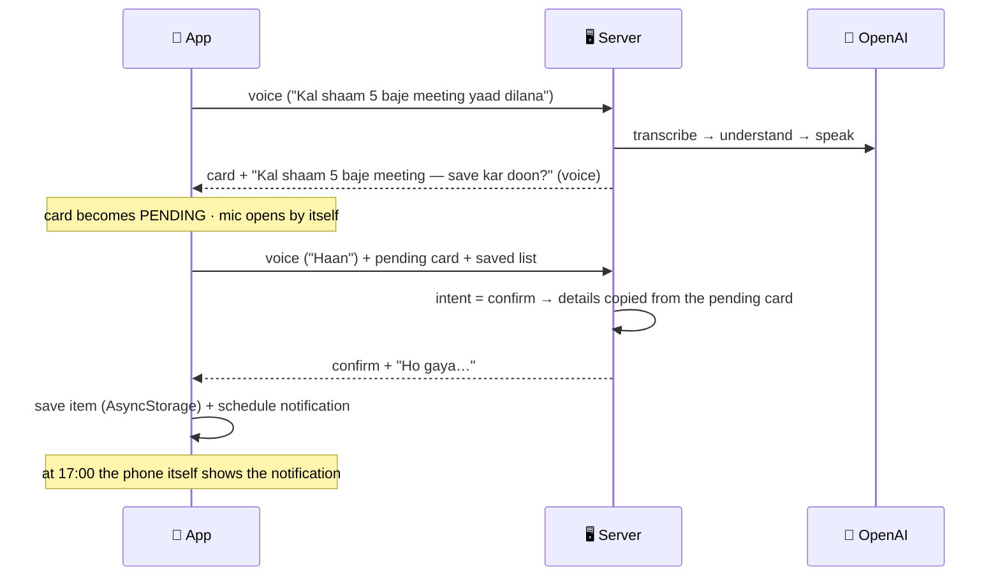

# 💾 Voice Assistant — Productivity Tools

### Experiment 06 · Part 4: Keep the Promise


In Part 3 the assistant said "Theek hai, yaad dila dunga"… and then nothing happened, because it never saved anything. Part 4 makes it **keep its promise**.

The assistant now asks before saving, you answer with your voice, and a reminder turns into a **real notification** that fires on a locked phone, in your own words:

```text
You:        "Do minute baad mujhe mummy ko call karne ki yaad dilana."
Assistant:  🔊 "Do minute baad mummy ko call — save kar doon?"   ← mic opens by itself
You:        "Haan."
            📋 My Plan: ⏰ Mummy ko call · 🔔
            … phone locked …
            🔔 ⏰ Mummy ko call — You said: "Do minute baad mujhe mummy ko call karne ki yaad dilana."
```

This is Part 4 of the five-part [Voice Productivity Assistant](../README.md) series.

---

## 📑 Table of Contents

- [Core Concept](#-core-concept)
- [Series Roadmap](#-series-roadmap)
- [The Answer: Three Parts](#-the-answer-three-parts)
- [How It Works](#-how-it-works)
- [What's New in the Code](#-whats-new-in-the-code)
- [API](#-api)
- [Project Structure](#-project-structure)
- [Requirements](#-requirements)
- [Backend Setup](#-backend-setup)
- [Test the Backend](#-test-the-backend)
- [Run the Mobile Application](#-run-the-mobile-application)
- [Troubleshooting](#-troubleshooting)
- [Security](#-security)
- [What We Learned](#-what-we-learned)
- [About Harihar Code Studio](#-about-harihar-code-studio)

---

## 💡 Core Concept

> **An assistant is only useful if what it understands leaves a trace: a list, a reminder, a notification.**

| Part | The app could… |
| --- | --- |
| P1 | **hear** (speech → text) |
| P2 | **understand** (text → action) |
| P3 | **speak** (reply → voice) |
| **P4** | **remember**: save on the phone + real notifications |

Nothing is saved without your **yes**: the AI suggests, you decide.

---

## 🗺 Series Roadmap

| Part | Topic | What the app gains |
| --- | --- | --- |
| P1 | Speech-to-Text | Hears and writes |
| P2 | AI Assistant | Understands what you want and replies |
| P3 | Text-to-Speech | Speaks the reply |
| **P4** | **Productivity Tools** | **Saves reminders, tasks and notes; real notifications (this folder)** |
| P5 | Real-Time Voice | Live conversation, like a phone call |

---

## ✅ The Answer: Three Parts

| # | What happens |
| --- | --- |
| 1 | **Ask first.** For a complete reminder, task or note the assistant repeats the key detail and asks "**save kar doon?**". You say **haan**, **nahi**, or change a detail ("**6 baje kar do**"). |
| 2 | **Save + notify.** On "haan" the app saves the item on the phone (AsyncStorage) and, for a reminder, schedules a **local notification** at the right time. No server or internet is needed when it fires. |
| 3 | **Ask about your plan.** Your saved list goes along with each request, so "**Mera kal ka plan kya hai?**" is answered, out loud, from your own list only. |

---

## 🔄 How It Works



### Haan, nahi, or change

| You say (with a pending card) | Intent | What the app does |
| --- | --- | --- |
| "Haan" / "theek hai" / "save karo" | `confirm` | Saves the pending card + schedules the notification |
| "Nahi" / "rehne do" | `cancel` | Clears the pending card |
| "6 baje kar do" / "Nahi, 6 baje kar do" | `reminder` (updated) | New card becomes pending; asks again |

> [!NOTE]
> On `confirm` / `cancel` the server **does not** take title, date, time or people from the AI. It copies them from the pending card the user actually saw: *jo dekha, wahi save*.

---

## 🧩 What's New in the Code

| File | Status | What it does |
| --- | --- | --- |
| `server/src/assistant.ts` | edit | `confirm` / `cancel` intents, `SAVABLE`, the "Part 4" rules, `checkAction(raw, pending)`, `checkPending`, `dayFor` (a time with no day → today or tomorrow) |
| `server/src/index.ts` | edit | `readExtra`: context + pending (checked) + saved items (≤ 3000 chars) for both assistant routes |
| `server/src/speak.ts` | edit | `forSpeech`: numbers above 12 and clock times are spoken in English, so 39 isn't heard as 29 |
| `mobile/src/store/items.ts` | **new** | `loadItems` / `storeItems` (AsyncStorage), `newItem`, `sortItems`, `summarize` |
| `mobile/src/notify/reminders.ts` | **new** | Channel + permission, `fireTime`, `scheduleFor` (exact alarm), `cancelFor` |
| `mobile/src/components/Upcoming.tsx` | **new** | "My Plan": timed items first, 🔔 when a notification is set, ✓ to finish |
| `mobile/src/components/ActionCard.tsx` | edit | 💾 SAVED / ✕ CANCELLED labels, **Save** and **Not now** buttons |
| `mobile/src/api/voice.ts` | edit | `askAssistant(uri, { context, pending, items })` |
| `mobile/app/(tabs)/index.tsx` | edit | `sendVoice` handles haan / nahi / change; mic reopens after "save kar doon?" |
| `mobile/app.json` | edit | `expo-notifications` plugin + `USE_EXACT_ALARM` |

Two new libraries: `expo-notifications` and `@react-native-async-storage/async-storage`.

> [!TIP]
> Reminders are scheduled with `delivery: "alarmClock"`. Android never delays these for battery saving, so "do minute baad" really fires after two minutes, even on a locked phone with aggressive battery management.

---

## 📡 API

Same endpoints as [Part 3](../part-3/README.md#-api). Both assistant routes accept three optional extras:

| Field | Type | Meaning |
| --- | --- | --- |
| `context` | string | The sentence before a follow-up question |
| `pending` | JSON string (or object in a JSON body), ≤ 2000 chars | The card waiting for haan / nahi / change. Checked by the server; only a complete reminder, task or note is accepted. |
| `items` | string, cut to 3000 chars | The saved list, one line per item: `date · time · intent · title · people` |

---

## 🗂 Project Structure

```text
experiment-06/
├── README.md                 ← series overview
├── part-1/ … part-3/
└── part-4/
    ├── README.md             ← this file
    ├── server/
    │   └── src/
    │       ├── assistant.ts      ← + confirm / cancel, Part 4 rules, pending check, dayFor
    │       ├── index.ts          ← + readExtra
    │       └── speak.ts          ← + forSpeech (numbers in English)
    └── mobile/
        ├── app/(tabs)/index.tsx  ← haan / nahi / change, save, My Plan
        └── src/
            ├── store/items.ts        ← saved list (AsyncStorage)
            ├── notify/reminders.ts   ← real notifications
            ├── components/
            │   ├── ActionCard.tsx    ← + Save / Not now
            │   └── Upcoming.tsx      ← My Plan
            ├── api/voice.ts
            └── types.ts              ← + SavedItem, Pending
```

---

## 🧰 Requirements

Same as [Part 3](../part-3/README.md#-requirements). The app needs a **new native build**, because `expo-notifications` and AsyncStorage are native modules.

---

## 🚀 Backend Setup

```bash
cd ai/experiment-06/part-4/server
npm install
cp .env.example .env      # same keys as Part 3
npm run dev
```

---

## 🧪 Test the Backend

**1 · A new reminder asks before saving**

```bash
curl -s -X POST http://localhost:3006/api/assistant \
  -H "Content-Type: application/json" \
  -d '{"text":"Kal shaam 5 baje meeting yaad dilana"}' | jq '.action | {intent, time, reply}'
# { "intent": "reminder", "time": "17:00", "reply": "Kal shaam 5 baje meeting — save kar doon?" }
```

**2 · "Haan" with the pending card → confirm (time comes from the pending card)**

```bash
curl -s -X POST http://localhost:3006/api/assistant \
  -H "Content-Type: application/json" \
  -d '{"text":"Haan","pending":"{\"intent\":\"reminder\",\"title\":\"Meeting\",\"date\":\"2026-12-01\",\"time\":\"17:00\",\"people\":[],\"priority\":\"normal\",\"needsClarification\":false,\"question\":null,\"reply\":\"\"}"}' \
  | jq '.action | {intent, time, reply}'
# { "intent": "confirm", "time": "17:00", "reply": "Ho gaya, shaam 5 baje meeting yaad dila dunga." }
```

**3 · Change a detail → new card, asks again**

```bash
curl -s -X POST http://localhost:3006/api/assistant \
  -H "Content-Type: application/json" \
  -d '{"text":"6 baje kar do","pending":"{\"intent\":\"reminder\",\"title\":\"Meeting\",\"date\":\"2026-12-01\",\"time\":\"17:00\",\"people\":[],\"priority\":\"normal\",\"needsClarification\":false,\"question\":null,\"reply\":\"\"}"}' \
  | jq '.action | {intent, time, reply}'
# { "intent": "reminder", "time": "18:00", "reply": "Shaam 6 baje meeting — save kar doon?" }
```

**4 · Ask about the plan (answered only from the saved list)**

```bash
curl -s -X POST http://localhost:3006/api/assistant \
  -H "Content-Type: application/json" \
  -d '{"text":"Mera kal ka plan kya hai?","items":"2026-12-01 · 09:00 · reminder · Client ko call · client\n2026-12-01 · 18:00 · reminder · Meeting"}' \
  | jq '.action | {intent, reply}'
# { "intent": "question", "reply": "Subah 9 baje client ko call aur shaam 6 baje meeting hai." }
```

**5 · "Haan" with nothing pending is not a confirm**

```bash
curl -s -X POST http://localhost:3006/api/assistant \
  -H "Content-Type: application/json" -d '{"text":"Haan"}' | jq '.action.intent'
# "other"
```

Use a date in the future for `pending`. For "kal" to match, set the dates in `pending` and `items` to **tomorrow** (the examples use 1 Dec 2026).

---

## 📱 Run the Mobile Application

The app needs a fresh native build for the two new modules:

```bash
cd ai/experiment-06/part-4/mobile
npm install
cp .env.example .env.local      # set your computer's Wi-Fi IP
npx expo run:android --device   # Android: needs this native build
# iPhone: Expo Go works → npx expo start, scan the QR code
```

> [!IMPORTANT]
> On **Android, don't use Expo Go**: it rejects the notification channel (`setNotificationChannelAsync … NullPointerException`), so reminders won't pop up. Use the build from `npx expo run:android`. On **iPhone**, Expo Go is fine; the notification just shows "Expo Go" as the app name.

On first launch, **allow notifications**. Then try:

| # | Say | Expect |
| --- | --- | --- |
| 1 | "Kal subah 9 baje client ko call karna hai" → **"Haan"** | 💾 SAVED · My Plan: ⏰ Client ko call · Tomorrow · 9:00 AM 🔔 |
| 2 | "Kal meeting yaad dilana" → "Shaam 5 baje" → **"Nahi, 6 baje kar do"** → **"Haan"** | Card changes 5 → 6, then saved at 6:00 PM |
| 3 | "Note kar lo, gaadi B2 parking mein slot 45 par hai" → **"Haan"** | 📝 note at the bottom of the list, no bell |
| 4 | "Mera kal ka plan kya hai?" | It reads back only what's in your list |
| 5 | "Do minute baad mujhe paani peene ki yaad dilana" → **"Haan"** → lock the phone | 🔔 notification after two minutes, in your words |

Say "haan" only after "save kar doon?" has finished. The mic opens by itself. You can also tap **💾 Save** or **Not now** on the card, and **✓** in My Plan marks an item done and cancels its notification.

---

## 🛠 Troubleshooting

| Symptom | Fix |
| --- | --- |
| No notification | Settings → Apps → *Voice Assistant* → Notifications ON. Battery saver OFF. Check the time on the card. |
| "Haan" didn't save | Let "save kar doon?" finish so the mic opens by itself, then say it, or tap **Save**. |
| `expo-notifications` error | It's a new native module: rebuild with `npx expo run:android`. |
| `setNotificationChannelAsync` rejected (NullPointerException) | You're in Expo Go on Android. Open the **Voice Assistant** app built with `npx expo run:android` instead. |
| Assistant answers something you didn't say | The mic heard someone nearby. Check the "You said" card and record again in a quiet room. |
| "Shaam 6 baje" saved with no day | Fixed by `dayFor`: today if 6 PM is still ahead, otherwise tomorrow. |
| Voice says the wrong number (39 → 29) | Hindi number names sound alike. `forSpeech` says them in English: "four thirty-nine baje". |
| `Can't reach server` | Same Wi-Fi, IP in `.env.local`, `npx expo start -c`. |

---

## 🔐 Security

> [!WARNING]
> - The list stays **on the phone** (AsyncStorage). The server only sees a short summary while answering a question, and doesn't store it.
> - A pending card sent by the app is **checked again on the server**, like any other input.
> - On "haan" the saved details come from the card the user saw, never from a fresh AI answer.
> - Nothing is saved without the user's yes (voice or the Save button).
> - The OpenAI key stays on the server; CORS is open for local development only.

---

## 📚 What We Learned

- [x] Confirm-before-save: the AI suggests, the user decides
- [x] `confirm` / `cancel` intents and treating "nahi, 6 baje kar do" as a change
- [x] Copying details from the pending action so the model can't change what gets saved
- [x] Sending app state (pending card, saved list) with each voice request
- [x] Saving on the phone with AsyncStorage
- [x] Real local notifications with `expo-notifications`, Android channels and exact alarms
- [x] Relative times: "do minute baad", "2 ghante baad", and a time with no day (`dayFor`)
- [x] Making TTS say numbers right: `forSpeech` turns 39 into "thirty-nine" so it isn't heard as 29
- [x] Answering "mera plan kya hai?" only from the user's own data

---

## ✅ Experiment Status

**Experiment 06 · Part 4: Completed**

### ⏭ Next

**Part 5 — Real-Time Voice:** no more record → send → wait. A live conversation, like a phone call, where the assistant understands while you speak.

---

## 🎓 About Harihar Code Studio

**Harihar Code Studio** focuses on practical software engineering tutorials covering:

`React Native` · `Mobile Engineering` · `Artificial Intelligence` · `LLM Integrations` · `AI Architecture` · `Developer Tools` · `Production Engineering`

The goal is to understand not only **how** to implement a feature, but also the **architecture and engineering decisions** behind it.
