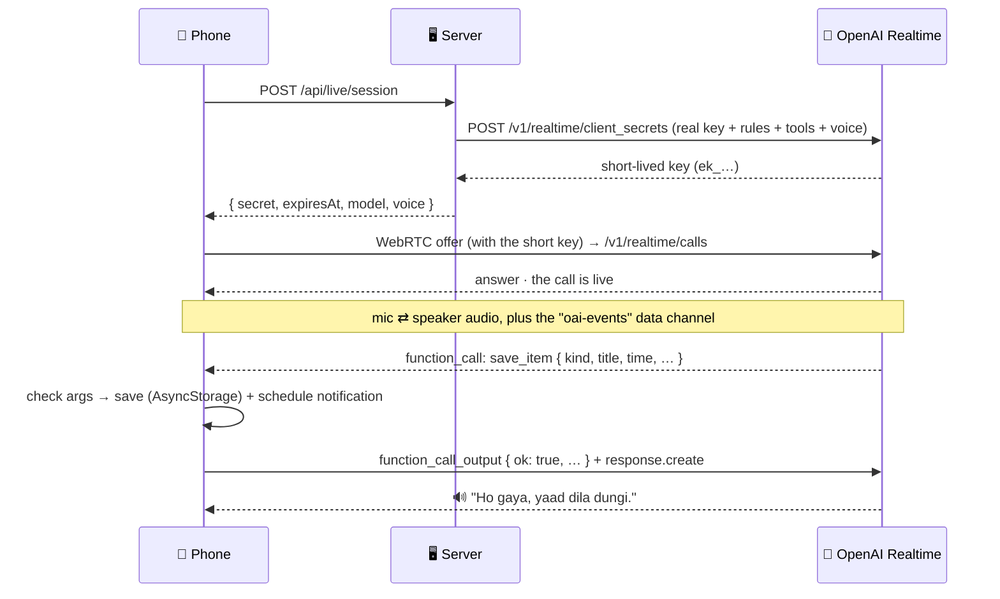

# 📞 Voice Assistant — Real-Time Voice

### Experiment 06 · Part 5: Talk Like a Phone Call


Parts 1–4 worked like a walkie-talkie: tap the mic, speak, stop, upload, wait, listen. Part 5 removes every one of those steps. You tap **Live call** once, and then you just **talk**. She answers while you're still on the line, you can interrupt her mid-sentence, and she saves reminders on your phone by herself.

```text
You:        (taps 📞 Live call)
Assistant:  🔊 "Haan boliye, main sun rahi hoon."
You:        "Kal subah 9 baje client ko call karna hai."
Assistant:  🔊 "Kal subah 9 baje client ko call — save kar…"
You:        "Nahi, 10 baje kar do."          ← you cut in, she stops at once
Assistant:  🔊 "Theek hai, kal subah 10 baje — save kar doon?"
You:        "Haan."
            🔧 save_item  →  📋 My Plan: ⏰ Client ko call · Tomorrow · 10:00 AM · 🔔
```

This is Part 5, the last part of the [Voice Productivity Assistant](../README.md) series.

---

## 📑 Table of Contents

- [Core Concept](#-core-concept)
- [Series Roadmap](#-series-roadmap)
- [The Answer: Three Parts](#-the-answer-three-parts)
- [How It Works](#-how-it-works)
- [What's New in the Code](#-whats-new-in-the-code)
- [Choose the Assistant's Voice](#-choose-the-assistants-voice)
- [API](#-api)
- [Project Structure](#-project-structure)
- [Backend Setup](#-backend-setup)
- [Test the Backend](#-test-the-backend)
- [Run the Mobile Application](#-run-the-mobile-application)
- [Troubleshooting](#-troubleshooting)
- [Security](#-security)
- [What We Learned](#-what-we-learned)
- [About Harihar Code Studio](#-about-harihar-code-studio)

---

## 💡 Core Concept

> **A conversation is not "send a file, get a file". It is two audio streams, open at the same time.**

| | Parts 1–4 | Part 5 |
| --- | --- | --- |
| Audio to the AI | recorded file, uploaded after you stop | live stream from the mic (WebRTC) |
| Audio from the AI | MP3 after a 3-step pipeline | live stream to the speaker |
| Turn-taking | silence timer in the app | the model decides when you finished (`semantic_vad`) |
| Interrupt | tap the mic | just speak |
| Saving | server returns a card, the app saves it | the assistant calls a **tool**, the phone runs it |

---

## 🗺 Series Roadmap

| Part | Topic | What the app gains |
| --- | --- | --- |
| P1 | Speech-to-Text | Hears and writes |
| P2 | AI Assistant | Understands what you want and replies |
| P3 | Text-to-Speech | Speaks the reply |
| P4 | Productivity Tools | Saves reminders, tasks and notes; real notifications |
| **P5** | **Real-Time Voice** | **A live call: talk, interrupt, and she saves things with tool calls (this folder)** |

---

## ✅ The Answer: Three Parts

| # | What happens |
| --- | --- |
| 1 | **Stream, don't upload.** The phone's audio flows straight to OpenAI and her voice flows straight back, both at the same time, over **WebRTC**, the way a phone call works. |
| 2 | **The model takes turns.** The Realtime model works out when you've finished your sentence (`semantic_vad`), and stops talking the moment you cut in. |
| 3 | **She does the work.** When she needs to save a reminder or read your plan, she sends a **tool call**. The phone runs it (AsyncStorage + a real notification, as in Part 4) and sends back the result. |

---

## 🔄 How It Works

Think of a hotel key card. Your server is the reception and keeps the real master key. It hands the phone a short-lived key card, and the phone uses that to go straight to its room: OpenAI.



> [!NOTE]
> The rules, tools, voice and turn detection are locked into the short-lived key by the server, so the app can't change them. The app only runs the two tools.

---

## 🧩 What's New in the Code

| File | Status | What it does |
| --- | --- | --- |
| `server/src/live.ts` | **new** | `LIVE_VOICES` + `pickVoice`, the two tools (`save_item`, `get_plan`), `liveInstructions`, `createLiveSecret` |
| `server/src/index.ts` | edit | `POST /api/live/session`, `REALTIME_MODEL` check, realtime model + voice in `/health` |
| `server/labs/05-realtime.ts` | **new** | `npm run lab:5`: gets a live-call key from the terminal (prints only its length) |
| `server/src/assistant.ts`, `speak.ts` | edit | The assistant is a woman: feminine Hindi ("yaad dila dungi"); Part 3's voice defaults to `coral` |
| `mobile/src/api/live.ts` | **new** | Asks our server for the short-lived key |
| `mobile/src/live/call.ts` | **new** | WebRTC call: mic + speaker, `oai-events` data channel, offer/answer, events, tool loop |
| `mobile/src/live/tools.ts` | **new** | Runs `save_item` / `get_plan` on the phone; checks every argument; `in_minutes` → phone clock |
| `mobile/app/live.tsx` | **new** | The call screen: pulsing assistant avatar, call timer, chat bubbles, "Saved ✓" toast, Mute / Speaker / End |
| `mobile/app/(tabs)/index.tsx` | edit | New home: just the **Call your assistant** card and My Plan. The Part 4 record → send → wait mic is gone; the live call does all of it. The list reloads when you come back. |
| removed | — | `ActionCard.tsx`, `mic-button.tsx`, `api/voice.ts`, `audio/player.ts`: only the old mic flow used them |
| `mobile/src/components/Upcoming.tsx` | edit | My Plan in sections (Today · Tomorrow · Later · Notes · Done); **✓ Done** and **🗑 Delete** on every item |
| `mobile/src/constants/brand.ts` | edit | New "call" theme: deep indigo, violet for the assistant, green for call / done, red for end / delete |
| `mobile/app.json` | edit | WebRTC config plugin + mic permission text |

Three new libraries: `react-native-webrtc`, `@config-plugins/react-native-webrtc` and `react-native-incall-manager` (WebRTC plays through the earpiece by default; this puts it on the loudspeaker).

### Done and Delete

| Button | What it does |
| --- | --- |
| ✓ **Done** | Keeps the item (struck through, in *Done*), cancels its notification, and leaves it out of "mera plan kya hai?" |
| 🗑 **Delete** | Asks first, then removes the item from AsyncStorage for good and cancels its notification |

> [!TIP]
> **`in_minutes`**: the model has no clock. For "do minute baad" it sends `in_minutes: 2`, and the phone adds that to its own clock, rounded up to the next full minute. That's why the reminder fires exactly on time.

---

## 🎙 Choose the Assistant's Voice

She's a young woman who speaks clear Hindi and clear English. The voice is one line in `server/.env`:

```text
REALTIME_VOICE=marin
```

| Voice | Sounds like | Live call | Text-to-Speech (Part 3) |
| --- | --- | :-: | :-: |
| **marin** ⭐ | female · newest, best quality | ✅ | ✅ |
| **coral** | female · warm, friendly | ✅ | ✅ |
| **shimmer** | female · soft, calm | ✅ | ✅ |
| **sage** | female · calm, clear | ✅ | ✅ |
| cedar | male · newest, best quality | ✅ | ✅ |
| ash · echo · verse | male | ✅ | ✅ |
| alloy · ballad | neutral · expressive | ✅ | ✅ |
| nova · fable · onyx | — | ❌ | ✅ |

OpenAI doesn't label voices by gender; the table is how they sound. Listen first in the OpenAI Audio playground (Text to speech → Voice). A wrong name falls back to `marin` (`pickVoice()` in `server/src/live.ts`).

---

## 📡 API

Everything from [Part 4](../part-4/README.md#-api) still works. One new route:

| Method | Path | Returns |
| --- | --- | --- |
| `POST` | `/api/live/session` | `{ "secret": "ek_…", "expiresAt": 1793548700, "model": "gpt-realtime-2.1", "voice": "marin" }` |

The two tools the assistant can call during the call (they run on the phone):

| Tool | Arguments | Phone returns |
| --- | --- | --- |
| `save_item` | `kind`, `title`, `date`, `time`, `in_minutes`, `people`, `priority`, `said` | `{ ok, saved, date, time, reminder_set }` or `{ ok: false, error }` |
| `get_plan` | none | `{ ok, items }`: the saved list, one line per item |

---

## 🗂 Project Structure

```text
experiment-06/
├── README.md                 ← series overview
├── part-1/ … part-4/
└── part-5/
    ├── README.md             ← this file
    ├── server/
    │   ├── labs/05-realtime.ts   ← new: npm run lab:5
    │   └── src/
    │       ├── live.ts           ← new: voices, tools, rules, createLiveSecret
    │       ├── index.ts          ← + POST /api/live/session
    │       ├── assistant.ts
    │       └── speak.ts
    └── mobile/
        ├── app/
        │   ├── live.tsx          ← new: the call screen
        │   └── (tabs)/index.tsx  ← + 📞 Live call button
        └── src/
            ├── api/live.ts       ← new: get the short-lived key
            ├── live/
            │   ├── call.ts       ← new: WebRTC call + tool loop
            │   └── tools.ts      ← new: save_item, get_plan
            ├── store/items.ts
            └── notify/reminders.ts
```

---

## 🚀 Backend Setup

```bash
cd ai/experiment-06/part-5/server
npm install
cp .env.example .env      # same keys as Part 4, plus REALTIME_MODEL and REALTIME_VOICE
npm run dev
# Server on http://localhost:3006 (… realtime: gpt-realtime-2.1)
```

---

## 🧪 Test the Backend

**1 · Lab: get a live-call key, no phone needed**

```bash
npm run lab:5
# Model: gpt-realtime-2.1 · Voice: marin (female · newest, best quality)
# Tools: save_item, get_plan
# Got a short-lived key (35 characters, starts with "ek_")
```

The lab prints only the key's length, never the key.

**2 · The route the phone calls**

```bash
curl -s -X POST http://localhost:3006/api/live/session | jq '{model, voice, expiresAt}'
# { "model": "gpt-realtime-2.1", "voice": "marin", "expiresAt": 1793548700 }
```

**3 · Health shows the realtime model and voice**

```bash
curl -s http://localhost:3006/health | jq '.models'
```

---

## 📱 Run the Mobile Application

WebRTC is native code, so **Expo Go can't run this part** (Android or iPhone). Build the app once:

```bash
cd ai/experiment-06/part-5/mobile
npm install
npx expo install react-native-webrtc @config-plugins/react-native-webrtc react-native-incall-manager
cp .env.example .env.local      # your computer's Wi-Fi IP
npx expo run:android --device   # iPhone: npx expo run:ios --device
```

Allow the **mic** and **notifications**, clear My Plan (✓ on every item), then tap **📞 Live call** and don't touch the phone. Just talk:

| # | Say | Expect |
| --- | --- | --- |
| 1 | "Kal shaam 5 baje meeting yaad dilana" → **"Haan"** | She asks "save kar doon?", then 🔧 `save_item`; meeting in My Plan with 🔔 |
| 2 | "Kal subah 9 baje client ko call karna hai" → while she's saying "save kar…", **"Nahi, 10 baje kar do"** → **"Haan"** | She stops at once, asks again with 10 baje; saved at 10:00 AM |
| 3 | "Do minute baad mujhe paani peene ki yaad dilana" → **"Haan"** | `in_minutes: 2`; the phone sets the exact time |
| 4 | "Mera kal ka plan kya hai?" | 🔧 `get_plan`, then she reads back only your list |
| 5 | End the call (red button) and lock the phone | 🔔 "Paani peena" notification after two minutes |

> [!TIP]
> Keep the phone away from the laptop speakers so her voice doesn't echo back into the mic. If she mishears, end the call and start a new one.

---

## 🛠 Troubleshooting

| Symptom | Fix |
| --- | --- |
| App crashes on start | You're in Expo Go. Build with `npx expo run:android` (or `run:ios`). |
| "Unable to load script" (red screen) | The phone lost its link to Metro, e.g. after an ADB restart. Run `adb reverse tcp:8081 tcp:8081`, then tap **Reload**. |
| Her voice comes from the earpiece, very quiet | `react-native-incall-manager` must be installed; rebuild the app. |
| `Can't reach server` | Same Wi-Fi, the IP in `.env.local`, then `npx expo start -c`. |
| `client_secrets failed (400/404)` | Check `REALTIME_MODEL` and `OPENAI_API_KEY` in the server's `.env` (don't open it on screen). |
| Your words show in Urdu script | Hindi and Urdu sound alike, so the transcription needs a hint. `createLiveSecret` sends the same rule as Part 1: Hindi in Roman letters. |
| She doesn't save | Say "Haan" clearly after "save kar doon?". The phone's logs should show a `save_item` tool call. |
| No notification | Settings → Apps → *Voice Assistant* → Notifications ON. |

---

## 🔐 Security

> [!WARNING]
> - The OpenAI key stays in the server's `.env`. The phone only ever holds a **short-lived key** that expires in minutes.
> - The assistant's rules, tools and voice are locked into that key on the server; the app can't change them.
> - Tool arguments come from a model, so `tools.ts` checks every field (kind, title, date and time formats, minutes range) before anything is saved.
> - Nothing is saved without the user's "haan", and her rules say so on the server, not in the app.
> - CORS is open for local development only.

---

## 📚 What We Learned

- [x] WebRTC with OpenAI Realtime: live audio both ways, no upload and no waiting
- [x] Short-lived keys with `client_secrets`: the real key never reaches the phone
- [x] `semantic_vad` turn detection and interrupting the assistant mid-sentence
- [x] Tool calls: the model asks, the phone does the work, `function_call_output` reports back
- [x] Checking model-made arguments before saving anything
- [x] `in_minutes`: the model has no clock, the phone does the time maths
- [x] Choosing the voice (`marin`) and making her speak feminine Hindi and clear English
- [x] Speakerphone audio with `react-native-incall-manager`

---

## ✅ Experiment Status

**Experiment 06 · Part 5: Completed**. The series is complete: **hear → understand → speak → remember → talk live.**

### ⏭ Your Turn

The whole assistant is yours now. Add your own tools to `LIVE_TOOLS` and `runTool`, a calendar or a WhatsApp message, and make it your own.

---

## 🎓 About Harihar Code Studio

**Harihar Code Studio** focuses on practical software engineering tutorials covering:

`React Native` · `Mobile Engineering` · `Artificial Intelligence` · `LLM Integrations` · `AI Architecture` · `Developer Tools` · `Production Engineering`

The goal is to understand not only **how** to implement a feature, but also the **architecture and engineering decisions** behind it.
