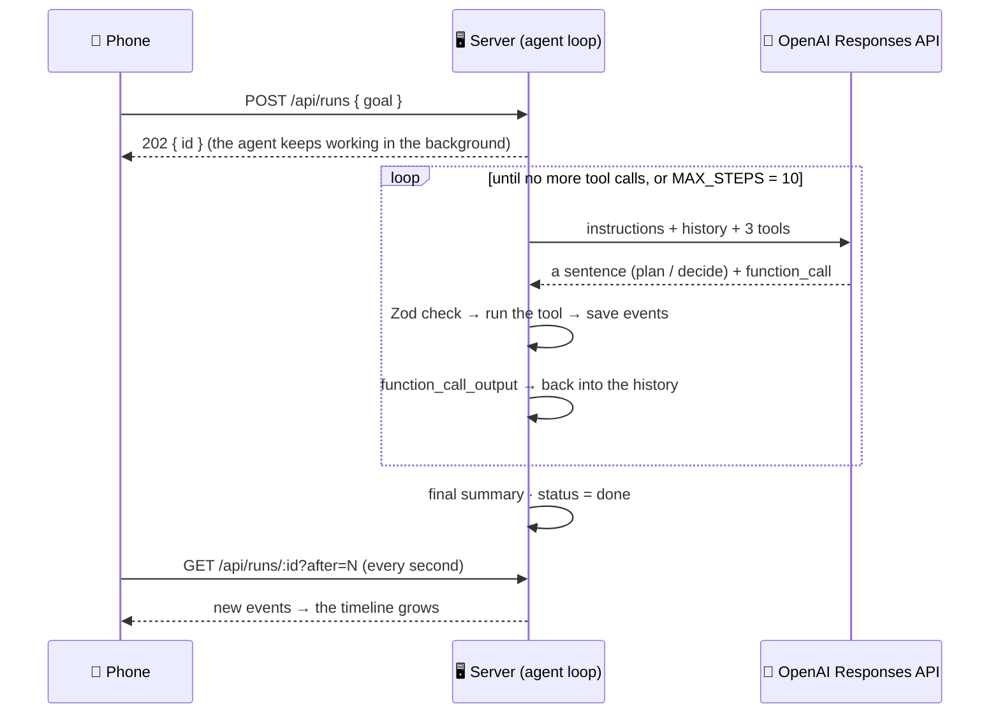

# 🤖 Mission Control — Intro to Agentic AI

### Experiment 07 · Part 1: Your First Agent


Ask a chatbot to *"prepare me for a Senior React Native interview in seven days"* and you get a nice list of advice. Your calendar is still empty. Part 1 builds an **agent**: same goal, but it works in a loop, uses tools, reads what happened, and keeps going until seven study sessions are on your calendar.

```text
GOAL      Prepare me for a Senior React Native interview in seven days.
PLAN      I'll check today's date first so I can schedule the plan correctly.
ACT       get_today {}
OBSERVE   { ok: true, date: "2026-11-03", weekday: "Tuesday" }
DECIDE    I'll schedule day one on React Native architecture.
ACT       create_task { title: "React Native architecture", day: "2026-11-03", minutes: 90 }
OBSERVE   { ok: true, saved: "2026-11-03 · React Native architecture" }
…         (six more days)
DONE      One session a day from November 3–9.        → 📅 7 tasks on the calendar
```

This is Part 1 of the [Personal AI Mission Control](../README.md) series.

---

## 📑 Table of Contents

- [Core Concept](#-core-concept)
- [Series Roadmap](#-series-roadmap)
- [How It Works](#-how-it-works)
- [The Code](#-the-code)
- [API](#-api)
- [Project Structure](#-project-structure)
- [Backend Setup](#-backend-setup)
- [Labs](#-labs)
- [Test the Backend](#-test-the-backend)
- [Run the Mobile Application](#-run-the-mobile-application)
- [Troubleshooting](#-troubleshooting)
- [Security](#-security)
- [What We Learned](#-what-we-learned)
- [About Harihar Code Studio](#-about-harihar-code-studio)

---

## 💡 Core Concept

> **A chatbot answers. A tool call does one thing. An agent loops until the goal is done.**

| | Chatbot (lab 1) | Tool call (lab 2) | Agent (lab 3) |
| --- | --- | --- | --- |
| Output | advice as text | one action | the whole goal, done |
| Uses tools | no | once | as many as it needs |
| Reads the result | — | no | yes, every time |
| Fixes its own mistakes | — | no | yes: an error comes back as an observation |
| Knows when to stop | — | stops after one step | stops when the goal is covered, or at `MAX_STEPS` |

---

## 🗺 Series Roadmap

| Part | Topic | What the app gains |
| --- | --- | --- |
| **P1** | **Intro to Agentic AI** | **The agent loop with three tools (this folder)** |
| P2 | Planning Engine | Goal → a checked, repaired, ordered plan |
| P3 | Execution Loop | Many tools, retries, verify by calendar, budgets |
| P4 | Memory & State | PostgreSQL, checkpoints, resume, long-term memory |
| P5 | Human-in-the-Loop | Policy engine, approvals, grants, expiry |
| P6 | Multi-Agent Team | Researcher + Planner + Executor, orchestrator, report |

---

## 🔄 How It Works

The model never runs anything. It only **asks** for a tool; our code checks the arguments, runs it, and hands the result back. That is one turn of the loop.



The three tools:

| Tool | Arguments | Returns |
| --- | --- | --- |
| `get_today` | none | `{ ok, date, weekday }`: the model has no clock, so it asks first |
| `create_task` | `title`, `day`, `minutes`, `notes` | `{ ok, id, saved }`, or `{ ok: false, error }` for a bad or past date |
| `list_tasks` | none | `{ ok, count, tasks }` |

> [!NOTE]
> A tool never throws. Bad JSON, a wrong type (`minutes: "lots"`) or a date in the past comes back as `{ ok: false, error }`, the model **observes** it, and it fixes the call on the next step.

---

## 🧩 The Code

| File | What it does |
| --- | --- |
| `server/src/agent.ts` | `runAgent`: the loop, the instructions, `MAX_STEPS = 10` |
| `server/src/tools.ts` | The three tools (name + Zod schema + `run`), `toolDefs` for the model, `callTool`: parse → check → run |
| `server/src/llm.ts` | One small door to OpenAI (`responses.create`). Tests swap in a fake model |
| `server/src/store.ts` | Runs, events and tasks, in memory (PostgreSQL comes in Part 4) |
| `server/src/app.ts` | Express routes; the run starts in the background and the phone polls |
| `server/src/clock.ts` | Today's date in India's time zone |
| `server/test/` | 4 tests with a scripted fake model: no key, no internet |
| `mobile/app/(tabs)/index.tsx` | **Mission** tab: goal box, example goals, **Launch agent**, the loop dial (PLAN → ACT → OBSERVE → DECIDE, with what each step means), run stats and "What the agent did". The dial stays pinned at the top during a run, and steps appear one at a time so the dial and the timeline move together |
| `mobile/app/(tabs)/calendar.tsx` | **My Plan** tab: one progress segment per task, hours planned, a day strip and a card per day; tap to mark done |
| `mobile/src/store.ts` | Zustand store: start, poll every second (only new events), tasks |
| `mobile/src/components/Timeline.tsx` | `LoopDial` (the step that just happened is coloured in, with a plain-English legend), `RunStats` (tasks added, tool calls, self-fixes) and the timeline, with tool calls and results in plain words |
| `mobile/src/components/ui.tsx`, `src/theme.ts` | Harihar Code Studio branding: logo header and a warm "planner paper" theme from the logo (cream, charcoal, orange, green), serif headings |

---

## 📡 API

| Method | Path | Body / query | Returns |
| --- | --- | --- | --- |
| `GET` | `/health` | — | `{ "ok": true, "part": 1, "model": "…" }` |
| `POST` | `/api/runs` | `{ "goal": "…" }` (5–600 characters) | `202 { "id": "…" }` |
| `GET` | `/api/runs/:id` | `?after=<seq>` | `{ id, goal, status, events }`: only events after `seq` |
| `GET` | `/api/tasks` | — | `{ "tasks": [ … ] }` sorted by day |
| `POST` | `/api/tasks/:id/toggle` | — | `{ "task": { … } }` |

---

## 🗂 Project Structure

```text
experiment-07/
├── README.md                 ← series overview
└── part-1/
    ├── README.md             ← this file
    ├── server/
    │   ├── labs/
    │   │   ├── 01-chatbot.ts     ← npm run lab:1
    │   │   ├── 02-tool-call.ts   ← npm run lab:2
    │   │   └── 03-agent.ts       ← npm run lab:3
    │   ├── src/
    │   │   ├── agent.ts  tools.ts  llm.ts  store.ts
    │   │   ├── app.ts    clock.ts  types.ts  index.ts
    │   └── test/
    │       ├── agent.test.ts
    │       └── helpers.ts        ← the fake model
    └── mobile/
        ├── app/
        │   ├── _layout.tsx
        │   └── (tabs)/  _layout.tsx  index.tsx  calendar.tsx
        ├── assets/images/hcs-logo.png   ← channel logo (app icon + header)
        ├── patches/                     ← Xcode 26 fix, applied on npm install
        └── src/
            ├── api.ts  store.ts  theme.ts  types.ts
            └── components/  Timeline.tsx  ui.tsx
```

---

## ⚙️ Backend Setup

Requirements: Node 20+ and an OpenAI API key. No database in this part (it comes in Part 4).

```bash
cd ai/experiment-07/part-1/server
npm install
cp .env.example .env
```

`.env`:

```text
OPENAI_API_KEY=your-key-here
AGENT_MODEL=gpt-6-luna
PORT=3007
```

`AGENT_MODEL` must support tools and Structured Outputs on your account.

```bash
npm run dev        # http://localhost:3007
```

---

## 🧪 Labs

These are optional, and the video only mentions them. Each lab shows one idea in the terminal, with the same goal. They need the real key.

| Command | Shows |
| --- | --- |
| `npm run lab:1` | A chatbot: advice only, the calendar stays empty |
| `npm run lab:2` | One tool call: one action, then it stops without reading the result |
| `npm run lab:3` | The agent: the whole loop, then "7 tasks are on the calendar" |

`npm run lab:3 -- "Plan my week to learn TypeScript generics, 1 hour a day."` runs it with your own goal.

---

## ✅ Test the Backend

```bash
npm test           # 4 tests, fake model, no key needed
npm run typecheck
```

| Test | Checks |
| --- | --- |
| plan → act → observe → decide → final | The events come in that order and the task is saved |
| a bad tool call becomes an observation | A past date returns `ok: false`, the model sees it and fixes it |
| wrong argument types never reach the tool | Zod stops `minutes: "lots"` |
| the step limit | An agent that never stops is stopped at `MAX_STEPS` |

Or try the API with curl:

```bash
curl -X POST http://localhost:3007/api/runs \
  -H "Content-Type: application/json" \
  -d '{"goal":"Prepare me for a Senior React Native interview in seven days."}'
```

---

## 📱 Run the Mobile Application

```bash
cd ai/experiment-07/part-1/mobile
npm install
EXPO_PUBLIC_API_URL=http://<your-mac-ip>:3007 npx expo start
```

Find your Mac's Wi-Fi IP with `ipconfig getifaddr en0`. The phone and the Mac must be on the same Wi-Fi. On the iOS Simulator `http://localhost:3007` works; on the Android Emulator use `http://10.0.2.2:3007`.

1. **Mission** tab → tap an example goal → **Launch agent**.
2. Watch the dial, pinned on top, move PLAN → ACT → OBSERVE → DECIDE while "What the agent did" grows below it, one step at a time.
3. Tap **Your plan is ready**, or open the **My Plan** tab: the seven sessions, day by day, with a progress bar. Tap a task to mark it done.

---

## 🛠 Troubleshooting

| Problem | Fix |
| --- | --- |
| "Can't reach the server" | Is the server running? Right IP in `EXPO_PUBLIC_API_URL`? Same Wi-Fi? Port 3007 allowed by the firewall? |
| `OPENAI_API_KEY is missing from .env` | Copy `.env.example` to `.env` and fill it in |
| Model not found | Change `AGENT_MODEL` to a model your account has |
| "Stopped: step limit reached" | The agent used all 10 steps. Part 3 adds proper budgets |
| Tasks gone after a restart | Expected: Part 1 keeps everything in memory |
| iOS build fails in `expo-modules-jsi` on Xcode 26 | Run `npm install` again in `mobile/`, which reapplies the fix in `patches/` |

---

## 🔒 Security

- The OpenAI key lives only in `server/.env`, which git ignores. The phone never sees it.
- The model can only **ask** for one of three tools. Our code checks every argument with Zod before anything runs.
- The goal is capped at 600 characters and the request body at 20 KB.

---

## 🎓 What We Learned

- An agent is a loop: **plan → act → observe → decide**, repeated until the goal is done.
- The model never runs code. It asks; our code checks and runs.
- Errors are just observations. The agent reads them and fixes its own call.
- Every agent needs a way to stop: here, `MAX_STEPS`.
- A fake, scripted model makes agent tests fast, free and repeatable.

---

## 🎓 About Harihar Code Studio

**Harihar Code Studio** focuses on practical software engineering tutorials covering:

`React Native` · `Mobile Engineering` · `Artificial Intelligence` · `LLM Integrations` · `AI Architecture` · `Developer Tools` · `Production Engineering`

The goal is to understand not only **how** to implement a feature, but also the **architecture and engineering decisions** behind it.
