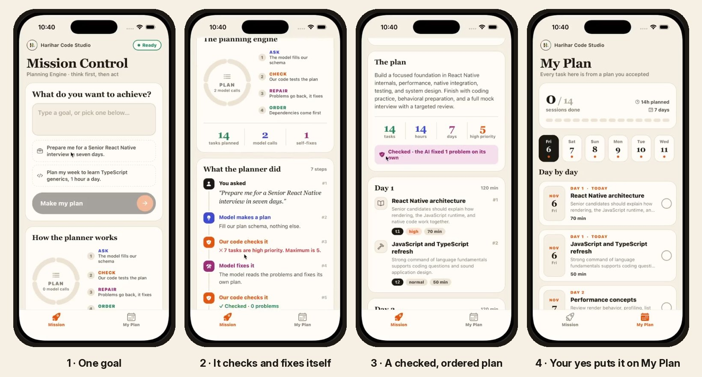
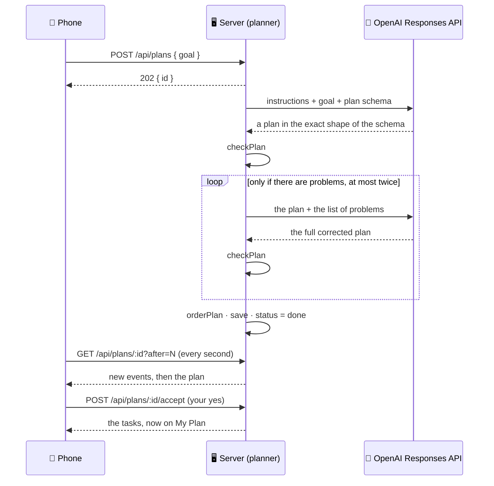

# 🧭 Mission Control — AI Planning Engine

### Experiment 07 · Part 2: Think First, Then Act


> **One goal in. A checked, ordered plan out. And when the AI gets it wrong, it fixes its own plan.**

The Part 1 agent started creating tasks straight away, without seeing the whole plan. What if step 3 depends on step 1? Part 2 adds a **planning engine**: the model fills a plan in a fixed shape, our code checks that it makes sense, the model repairs its own mistakes, and the tasks are put in order. Nothing reaches your calendar until you say yes.



```text
GOAL      Prepare me for a Senior React Native interview in seven days.
ASK       The model fills our plan schema.
CHECK     ✕ 6 tasks are high priority. Maximum is 5.
REPAIR    The model reads the problem and fixes its own plan.
CHECK     ✓ 0 problems
ORDER     t1 → t2 → t3 → t4 → …
DONE      A checked plan, waiting for your yes.          → Accept → 📅 My Plan
```

### ✨ Highlights

- 🧠 **Structured Outputs with Zod:** the model can only answer in the exact shape of the plan.
- 🛡 **A checker the model can't fool:** missing dependencies, future dependencies, loops, impossible days and too much "high priority" are all caught.
- 🔁 **Self-repair:** problems go back to the model as plain sentences, and it fixes its own plan, at most twice.
- 🧭 **Dependency order:** tasks are sorted so nothing comes before what it depends on.
- ✋ **Your yes first:** a plan reaches your calendar only after you accept it.
- 📱 **Live on the phone:** a pinned dial lights up Ask → Check → Repair → Order as the planner works.
- ✅ **16 tests** with a fake model: no API key, no cost.

This is Part 2 of the [Personal AI Mission Control](../README.md) series. It is built directly on [Part 1](../part-1/README.md): same design, same polling flow, same dial idea.

---

## 📑 Table of Contents

- [Core Concept](#-core-concept)
- [Series Roadmap](#-series-roadmap)
- [How It Works](#-how-it-works)
- [The Code](#-the-code)
- [API](#-api)
- [Project Structure](#-project-structure)
- [Backend Setup](#-backend-setup)
- [Labs](#-labs)
- [Test the Backend](#-test-the-backend)
- [Run the Mobile Application](#-run-the-mobile-application)
- [Troubleshooting](#-troubleshooting)
- [Security](#-security)
- [What We Learned](#-what-we-learned)
- [About Harihar Code Studio](#-about-harihar-code-studio)

---

## 💡 Core Concept

> **A schema checks the shape. Our code checks the sense.**

A form can accept "age: 200", because 200 is a number. A plan schema can accept a task that depends on `t9`, even when `t9` doesn't exist. So the model's plan goes through our own checker.

| | Part 1 agent | Part 2 planner |
| --- | --- | --- |
| Output | Tasks, created one by one | A whole plan, shown first |
| Order | None | `dependsOn`, checked and sorted |
| Priority | None | `high`, `normal`, `low`, with at most 1 in 3 high |
| Mistakes | Fixed one tool call at a time | Problems go back and the model repairs the plan |
| Calendar | Written straight away | Only after you accept |

---

## 🗺 Series Roadmap

| Part | Topic | What the app gains |
| --- | --- | --- |
| P1 | Intro to Agentic AI | The agent loop with three tools |
| **P2** | **Planning Engine** | **Goal → a checked, repaired, ordered plan (this folder)** |
| P3 | Execution Loop | Many tools, retries, verify by calendar, budgets |
| P4 | Memory & State | PostgreSQL, checkpoints, resume, long-term memory |
| P5 | Human-in-the-Loop | Policy engine, approvals, grants, expiry |
| P6 | Multi-Agent Team | Researcher + Planner + Executor, orchestrator, report |

---

## 🔄 How It Works

The planner runs in the background, and the phone polls for each step, the same way the agent worked in Part 1.



What `checkPlan` catches:

| Problem | Example |
| --- | --- |
| A dependency that doesn't exist | `t1 depends on t9, which does not exist.` |
| A dependency on a later day | `t2 (day 2) depends on t3, which is planned later (day 5).` |
| A day outside the plan | `t4: day 9 is outside 1 to 7.` |
| Bad time limits | `t5: 500 minutes is not between 15 and 180.` |
| Too much high priority | `6 tasks are high priority. Maximum is 5.` |
| Duplicate ids and loops | `The dependencies form a loop.` |

> [!NOTE]
> A plan that still has problems after two repairs is never shown. The run ends as failed, and there is nothing to accept.

---

## 🧩 The Code

| File | What it does |
| --- | --- |
| `server/src/schemas.ts` | `PlanSchema`: the shape of a plan, for Structured Outputs |
| `server/src/plan.ts` | `checkPlan`, `findCycle`, `orderPlan`, `makePlan` (ask, check, repair, order) and `runPlanner` |
| `server/src/app.ts` | The three plan routes, plus the Part 1 routes |
| `server/src/llm.ts` | `parse` is new: asks for an answer in the shape of a Zod schema. Tests swap in a fake model |
| `server/src/store.ts` | Plans, runs, events and tasks, in memory (PostgreSQL comes in Part 4) |
| `server/src/agent.ts`, `tools.ts` | The Part 1 agent loop, unchanged. Part 3 builds on it |
| `server/test/` | 16 tests with a scripted fake model: no key, no internet |
| `mobile/app/(tabs)/index.tsx` | **Mission** tab: goal, **Make my plan**, pinned dial, "What the planner did", the plan and **Accept this plan** |
| `mobile/app/(tabs)/calendar.tsx` | **My Plan** tab, as in Part 1. An accepted plan replaces the previous one |
| `mobile/src/components/Timeline.tsx` | `PlanDial` (Ask, Check, Repair, Order), `PlanStats` and the timeline |
| `mobile/src/components/PlanView.tsx` | The plan: stats, the checker's verdict and one card per day, with priority and `after t1` chips |
| `mobile/src/store.ts` | Zustand store: `makePlan`, `poll` and `acceptPlan` |

---

## 📡 API

| Method | Path | Body / query | Returns |
| --- | --- | --- | --- |
| `GET` | `/health` | — | `{ "ok": true, "part": 2, "model": "…" }` |
| `POST` | `/api/plans` | `{ "goal": "…" }` (5–600 characters) | `202 { "id": "…" }` |
| `GET` | `/api/plans/:id` | `?after=<seq>` | `{ id, goal, status, events, result }`: `result` is the plan once it's ready |
| `POST` | `/api/plans/:id/accept` | — | `{ "tasks": [ … ] }`. `409` if already accepted |
| `GET` | `/api/tasks` | — | `{ "tasks": [ … ] }` sorted by day |
| `POST` | `/api/tasks/:id/toggle` | — | `{ "task": { … } }` |
| `POST` | `/api/runs` | `{ "goal": "…" }` | The Part 1 agent, still available |
| `GET` | `/api/runs/:id` | `?after=<seq>` | The Part 1 agent's events |

---

## 🗂 Project Structure

```text
experiment-07/
├── README.md                 ← series overview
└── part-2/
    ├── README.md             ← this file
    ├── docs/screens.jpg      ← the screenshots above
    ├── server/
    │   ├── labs/
    │   │   ├── 01-chatbot.ts     ← npm run lab:1
    │   │   ├── 02-tool-call.ts   ← npm run lab:2
    │   │   ├── 03-agent.ts       ← npm run lab:3
    │   │   ├── 04-plan.ts        ← npm run lab:4
    │   │   └── 05-break-plan.ts  ← npm run lab:5
    │   ├── src/
    │   │   ├── plan.ts   schemas.ts  agent.ts  tools.ts
    │   │   ├── llm.ts    store.ts
    │   │   ├── app.ts    clock.ts  types.ts  index.ts
    │   └── test/
    │       ├── agent.test.ts
    │       ├── plan.test.ts
    │       └── helpers.ts        ← the fake model
    └── mobile/
        ├── app/
        │   ├── _layout.tsx
        │   └── (tabs)/  _layout.tsx  index.tsx  calendar.tsx
        ├── assets/images/hcs-logo.png   ← channel logo (app icon + header)
        ├── patches/                     ← Xcode 26 fix, applied on npm install
        └── src/
            ├── api.ts  store.ts  theme.ts  types.ts
            └── components/  PlanView.tsx  Timeline.tsx  ui.tsx
```

---

## ⚙️ Backend Setup

Requirements: Node 20+ and an OpenAI API key. No database in this part (it comes in Part 4).

```bash
cd ai/experiment-07/part-2/server
npm install
cp .env.example .env
```

`.env`:

```text
OPENAI_API_KEY=your-key-here
AGENT_MODEL=gpt-6-luna
PORT=3007
```

`AGENT_MODEL` must support tools and Structured Outputs on your account.

```bash
npm run dev        # http://localhost:3007
```

---

## 🧪 Labs

These are optional, and the video only mentions them. Labs 1 to 3 are from Part 1. Labs 1 to 4 need the real key.

| Command | Shows |
| --- | --- |
| `npm run lab:4` | A real plan from your goal, with the execution order and any problems fixed |
| `npm run lab:5` | No AI: a hand-made bad plan that the schema accepts and the checker rejects |

`npm run lab:4 -- "Plan my week to learn TypeScript generics, 1 hour a day."` runs it with your own goal.

---

## ✅ Test the Backend

```bash
npm test           # 16 tests, fake model, no key needed
npm run typecheck
```

| Tests | Check |
| --- | --- |
| The checker | Good plans pass. Missing or later dependencies, bad days and minutes, too much high priority, loops and duplicate ids are caught |
| The repair loop | Problems go back to the model, the repaired plan is accepted, and it gives up after two repairs |
| The order | Dependencies first, then earlier day, then higher priority |
| The API | Plan, watch the steps, accept. Nothing is saved before the yes, a new plan replaces the old one, and a broken plan can't be accepted |
| The Part 1 agent | The original 4 tests still pass |

Or try the API with curl:

```bash
curl -X POST http://localhost:3007/api/plans \
  -H "Content-Type: application/json" \
  -d '{"goal":"Prepare me for a Senior React Native interview in seven days."}'
```

---

## 📱 Run the Mobile Application

```bash
cd ai/experiment-07/part-2/mobile
npm install
EXPO_PUBLIC_API_URL=http://<your-mac-ip>:3007 npx expo start
```

Find your Mac's Wi-Fi IP with `ipconfig getifaddr en0`. The phone and the Mac must be on the same Wi-Fi. On the iOS Simulator `http://localhost:3007` works; on the Android Emulator use `http://10.0.2.2:3007`.

1. **Mission** tab → tap an example goal → **Make my plan**.
2. Watch the dial, pinned on top, move ASK → CHECK → REPAIR → ORDER while "What the planner did" grows below it. REPAIR only lights up if the checker found a problem.
3. Read the plan: stats, the checker's verdict, and the chips on each task.
4. Tap **Accept this plan**. My Plan opens with your tasks, day by day. Tap a task to mark it done.

---

## 🛠 Troubleshooting

| Problem | Fix |
| --- | --- |
| "Can't reach the server" | Is the server running? Right IP in `EXPO_PUBLIC_API_URL`? Same Wi-Fi? Port 3007 allowed by the firewall? |
| `OPENAI_API_KEY is missing from .env` | Copy `.env.example` to `.env` and fill it in |
| Model not found | Change `AGENT_MODEL` to a model your account has |
| "No valid plan" | The model couldn't fix the problems in two repairs. Try again |
| Tasks gone after a restart | Expected: this part keeps everything in memory. PostgreSQL arrives in Part 4 |
| iOS build fails in `expo-modules-jsi` on Xcode 26 | Run `npm install` again in `mobile/`, which reapplies the fix in `patches/` |

---

## 🔒 Security

- The OpenAI key lives only in `server/.env`, which git ignores. The phone never sees it.
- The model only returns a plan. Our code checks it, and nothing is saved until you accept it.
- The goal is capped at 600 characters and the request body at 20 KB.

---

## 🎓 What We Learned

- A schema checks the shape. Only our own code can check the sense.
- Problems written as clear sentences let the model repair its own plan.
- Dependencies give a plan its order, and they can be checked for loops.
- The user's yes belongs between the AI's plan and any real change.
- A repair loop needs a limit, just like the agent loop.

---

## 🎓 About Harihar Code Studio

**Harihar Code Studio** focuses on practical software engineering tutorials covering:

`React Native` · `Mobile Engineering` · `Artificial Intelligence` · `LLM Integrations` · `AI Architecture` · `Developer Tools` · `Production Engineering`

The goal is to understand not only **how** to implement a feature, but also the **architecture and engineering decisions** behind it.
