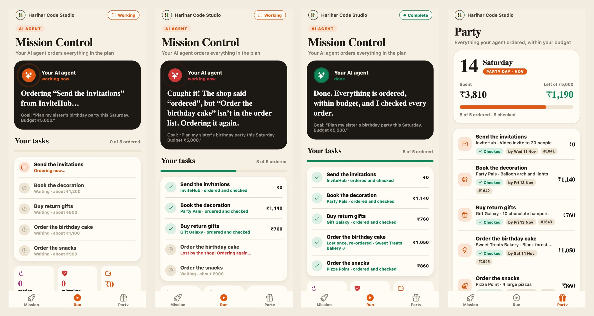
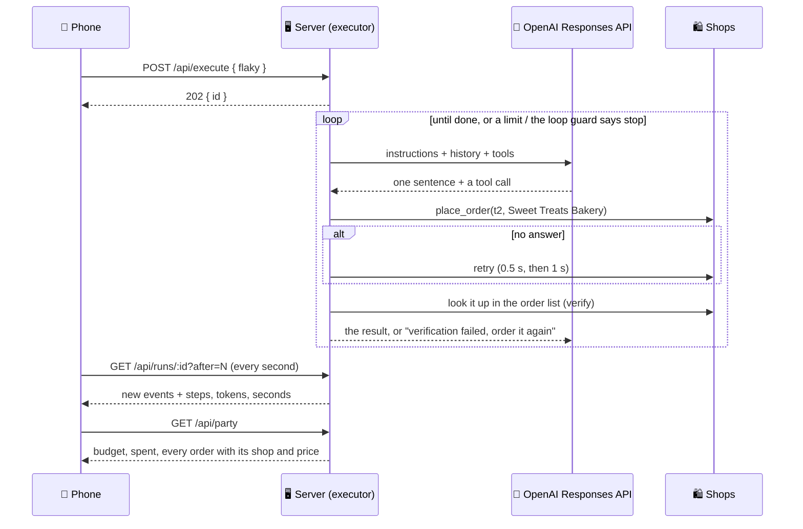

# 🧭 Mission Control: The Execution Loop

### Experiment 07 · Part 3: Act, Verify, Retry, Stop in Time


> **A plan is only a promise. This part makes the agent actually do the work, check it, and stop before it runs away.**

In Part 2 the agent made a checked plan and you accepted it. Nothing was actually done, though. In Part 3 an **executor agent** carries the plan out: you say *"Plan my sister's birthday party this Saturday. Budget ₹5,000."*, accept the plan, and the agent orders the cake, the decoration, the snacks and the return gifts from a street of shops, within your budget. Shops don't answer and orders get lost, so our code wraps the model in four safety nets: **retry**, **verify**, a **loop guard** and **budgets**.



```text
GOAL      Run the plan · 5 things to order · budget ₹5,000 · practice mode ON
DECIDE    I'll fetch the next task and its shops so I can choose within budget.
ACT       get_next_task()                    → t1 · invitations · QuickInvite, CardCraft, InviteHub
ACT       place_order(t1, InviteHub)
VERIFY    ✓ t1 · InviteHub · ₹0                     ← found in the shop's order list
ACT       place_order(t2, Sweet Treats Bakery)
RETRY     Sweet Treats Bakery didn't answer. Trying again in 0.5 s.
VERIFY    ✓ t2 · Sweet Treats Bakery · ₹1,140
ACT       place_order(t4, Pizza Point)              → the shop says "ordered"
VERIFY    ✕ t4 is NOT in the order list.            ← it lied. We caught it.
DECIDE    Pizza Point's order wasn't saved, so I'll try Snack Shack.
…
DONE      All 5 things ordered · ₹4,040 of ₹5,000 · 8 model calls · 27 s
```

### ✨ Highlights

- 🛍 **A street of shops:** pretend shops (no real orders, no real money) that behave like real ones. Every task has three choices with a price and a rating. Tools: `get_next_task`, `place_order` and `check_orders`.
- 💰 **A real budget:** the agent can never spend more than you gave it. An order over the budget is refused with a reason.
- 🔁 **Retry:** a shop that doesn't answer is not the model's fault. Our code waits and tries again, at most twice, with backoff.
- ✅ **Verify by order list:** "ordered" from a shop is not trusted. Every order is looked up in the shop's order list before it counts.
- 🧱 **Loop guard:** the third identical call is blocked. Three blocks and the run stops.
- ⏱ **Run limits:** steps, tokens and seconds. The run stops when any of them is used up.
- 🙅 **No fake "done":** if the model says it has finished but the order list disagrees, our code sends it back to work.
- 🧪 **Practice mode:** the shops fail on purpose, at fixed points, so you can watch a retry and a caught lost order every time.
- 📱 **Live on the phone:** the agent says what it is doing in one plain sentence, every task goes from *waiting* to *ordering* to *checked*, and the **Party** tab shows every order and the money left.
- ✅ **25 tests** with a fake model: no API key, no cost.

This is Part 3 of the [Personal AI Mission Control](../README.md) series. It is built directly on [Part 2](../part-2/README.md): same design, same polling flow, same planning engine.

---

## 📑 Table of Contents

- [Core Concept](#-core-concept)
- [Series Roadmap](#-series-roadmap)
- [How It Works](#-how-it-works)
- [The Four Safety Nets](#-the-four-safety-nets)
- [The Code](#-the-code)
- [API](#-api)
- [Project Structure](#-project-structure)
- [Backend Setup](#-backend-setup)
- [Labs](#-labs)
- [Test the Backend](#-test-the-backend)
- [Run the Mobile Application](#-run-the-mobile-application)
- [Troubleshooting](#-troubleshooting)
- [Security](#-security)
- [What We Learned](#-what-we-learned)
- [About Harihar Code Studio](#-about-harihar-code-studio)

---

## 💡 Core Concept

> **The model decides. Our code makes sure it really happened.**

An agent that only talks can be wrong for free. An agent that acts changes real things, and the real world is messy: shops don't answer, orders get lost, models get stuck repeating themselves. The model stays in charge of the decisions. The guarantees live in our code.

| | Part 2 planner | Part 3 executor |
| --- | --- | --- |
| Output | A plan with days and prices | Every task ordered from a real shop |
| Money | An estimate per task | A hard budget the agent cannot cross |
| Failures | A bad plan is repaired | No answer retried, lost orders caught, loops blocked |
| Trust | The checker reads the plan | The order list is read back after every order |
| Stopping | At most two repairs | Step, token and time limits, plus the loop guard |

---

## 🗺 Series Roadmap

| Part | Topic | What the app gains |
| --- | --- | --- |
| P1 | Intro to Agentic AI | The agent loop with three tools |
| P2 | Planning Engine | Goal → a checked, repaired, ordered plan |
| **P3** | **Execution Loop** | **The plan carried out: orders within budget, retry, verify, loop guard (this folder)** |
| P4 | Memory & State | PostgreSQL, checkpoints, resume, long-term memory |
| P5 | Human-in-the-Loop | Policy engine, approvals, grants, expiry |
| P6 | Multi-Agent Team | Researcher + Planner + Executor, orchestrator, report |

---

## 🔄 How It Works

You make a plan and accept it on the **Mission** tab, as in Part 2. Accepting also sets the budget. The **Run** tab then starts the executor in the background, and the phone polls for each step.



The shops are fixed so a recording can be repeated: for every task there are three choices, a cheaper one, one about the planned price and a premium one (0.8×, 0.95× and 1.4× the plan's estimate, rated 4.2, 4.7 and 4.9). The agent is told to pick the best-rated shop that fits the planned price.

---

## 🛡 The Four Safety Nets

| Net | Where | What it does | Limit |
| --- | --- | --- | --- |
| 🔁 Retry | `withRetry` in `execute.ts` | A `Transient` error (a shop that doesn't answer) is retried by our code. The model never sees it | 2 retries, 0.5 s then 1 s |
| ✅ Verify | `verifyOrder` in `shops.ts` | After every "ordered", look the order up in the order list: is it there, is the total within budget, are the tasks it depends on ordered? If not, the model is told to order again | Every order, plus a final check before "done" |
| 🧱 Loop guard | `runExecutor` | The same tool with the same arguments for the 3rd time is blocked | 3 blocks stop the run |
| 💰 Budgets | `place_order` and `BUDGET` in `execute.ts` | Money: an order over the budget left is refused. Run: steps, tokens and seconds are checked before every model call | Your ₹ budget · 30 steps · 250k tokens · 240 s |

> [!NOTE]
> **Practice mode** fails on purpose at fixed points: order #2 gets no answer once (watch the retry) and order #4 says "ordered" but saves nothing (watch verify catch it). Same run, same failures, every time.

What `place_order` refuses, with a reason the model can act on:

| Problem | Example |
| --- | --- |
| Over budget | `Over budget: Royal Cakes costs ₹2,800, only ₹2,500 is left. Pick a cheaper shop.` |
| The wrong shop | `Pizza Point does not sell this. Choose one of: Cake Corner, Sweet Treats Bakery, Royal Cakes.` |
| Something must come first | `t4 needs t1 first. Order that first.` |
| Already ordered | `t1 is already ordered from Cake Corner.` |

---

## 🧩 The Code

| File | What it does |
| --- | --- |
| `server/src/execute.ts` | **New.** The executor's three tools, `runExecutor` (the loop with limits, loop guard and the final check), `withRetry`, and practice mode |
| `server/src/shops.ts` | **New.** The pretend shops, `optionsFor` (three choices per task), `spent`, `orderList` and `verifyOrder` |
| `server/src/tools.ts` | `Transient` error: let through for retry. Every other error becomes an observation, as in Part 1 |
| `server/src/plan.ts`, `schemas.ts` | The Part 2 planner, now for events: every task has a `kind` and a `cost`, the plan has a `budget`, and the checker keeps the total under 90% of it |
| `server/src/app.ts` | `POST /api/execute`, `GET /api/party`. Accepting a plan sets the budget. Runs return `usage` and `budget` |
| `server/src/types.ts`, `store.ts` | A task now has `kind`, `cost`, `order` and `verified`. The store keeps the budget |
| `server/test/execute.test.ts` | 9 tests: the shops, happy path, refusals, retry, verify, loop guard, run budget, fake "done", and the full API |
| `mobile/app/(tabs)/run.tsx` | **Run tab:** the agent in one plain sentence, the task checklist, retries / mistakes caught / ₹ spent, practice mode, and the loop under **Behind the scenes** |
| `mobile/app/(tabs)/party.tsx` | **New Party tab:** the party day, spent and left, and every order with its shop, price and a ✓ Checked chip |
| `mobile/src/components/PlanView.tsx` | The plan with a price on every task, the total and the budget |
| `mobile/src/store.ts` | Zustand: `execute`, `pollExec`, `loadParty`, `flaky` |

---

## 📡 API

| Method | Path | Body / query | Returns |
| --- | --- | --- | --- |
| `GET` | `/health` | — | `{ "ok": true, "part": 3, "model": "…" }` |
| `POST` | `/api/plans` | `{ "goal": "…" }` | `202 { "id": "…" }` (Part 2) |
| `GET` | `/api/plans/:id` | `?after=<seq>` | Planner events, then the plan (Part 2) |
| `POST` | `/api/plans/:id/accept` | — | The tasks, nothing ordered yet. Sets the budget |
| `POST` | `/api/execute` | `{ "flaky": false, "fresh": false }` | `202 { "id": "…" }`. `400` with no accepted plan, `409` if everything is already ordered. `fresh: true` clears all orders first |
| `GET` | `/api/runs/:id` | `?after=<seq>` | `{ status, events, usage, budget }` |
| `GET` | `/api/party` | — | `{ budget, spent, day, items: [{ title, kind, cost, order, verified }] }` |
| `GET` | `/api/tasks` | — | `{ "tasks": [ … ] }` |
| `POST` | `/api/tasks/:id/toggle` | — | `{ "task": { … } }` |

---

## 🗂 Project Structure

```text
experiment-07/
├── README.md                 ← series overview
└── part-3/
    ├── README.md             ← this file
    ├── docs/screens.jpg      ← the screenshots above
    ├── server/
    │   ├── labs/
    │   │   ├── 01 … 05            ← from Parts 1 and 2
    │   │   ├── 06-execute.ts      ← npm run lab:6
    │   │   └── 07-stuck-agent.ts  ← npm run lab:7
    │   ├── src/
    │   │   ├── execute.ts  shops.ts         ← new in Part 3
    │   │   ├── plan.ts  schemas.ts  agent.ts  tools.ts
    │   │   ├── llm.ts   store.ts
    │   │   └── app.ts   clock.ts  types.ts  index.ts
    │   └── test/
    │       ├── execute.test.ts   ← new
    │       ├── plan.test.ts  agent.test.ts
    │       └── helpers.ts        ← the fake model
    └── mobile/
        ├── app/
        │   ├── _layout.tsx
        │   └── (tabs)/  _layout.tsx  index.tsx  run.tsx  party.tsx
        ├── assets/images/hcs-logo.png
        ├── patches/                     ← Xcode 26 fix, applied on npm install
        └── src/
            ├── api.ts  store.ts  theme.ts  types.ts
            └── components/  PlanView.tsx  Timeline.tsx  ui.tsx
```

---

## ⚙️ Backend Setup

Requirements: Node 20+ and an OpenAI API key. No database in this part (it comes in Part 4).

```bash
cd ai/experiment-07/part-3/server
npm install
cp .env.example .env
```

`.env`:

```text
OPENAI_API_KEY=your-key-here
AGENT_MODEL=gpt-6-luna
PORT=3007
```

`AGENT_MODEL` must support tools and Structured Outputs on your account.

```bash
npm run dev        # http://localhost:3007
```

---

## 🧪 Labs

These are optional, and the video only mentions them. Labs 1 to 3 are from Part 1, labs 4 and 5 from Part 2 (now with party plans).

| Command | Shows |
| --- | --- |
| `npm run lab:4` | A real model turns the birthday goal into a checked plan with prices |
| `npm run lab:6` | A real model orders a 5-task party within ₹5,000, then prints every step and what it spent |
| `npm run lab:6 -- --flaky` | The same, with a shop that doesn't answer and a lost order |
| `npm run lab:7` | No AI: a stuck fake model that repeats itself, blocked by the loop guard and stopped |

---

## ✅ Test the Backend

```bash
npm test           # 25 tests, fake model, no key needed
npm run typecheck
```

| Tests | Check |
| --- | --- |
| The shops | Three choices per task: cheaper, about right, premium |
| The loop | next → order → verify → order → verify → done, with the total |
| Refusals | Must-come-first, wrong shop, over budget, already ordered |
| Retry | A shop that doesn't answer is retried by our code, and the run still finishes |
| Verify | An order the shop silently dropped is caught, ordered again and verified |
| Loop guard | A stuck model is blocked three times, then stopped |
| Run budget | The run stops when its step budget is used up |
| Fake "done" | The model can't finish while the order list is missing a task |
| The API | Plan → accept → execute → party within budget, and `409` when nothing is left |
| The planner | Party plans: prices, the 90% budget rule, too few tasks, dependencies, loops |
| Part 1 | The original agent tests still pass |

---

## 📱 Run the Mobile Application

```bash
cd ai/experiment-07/part-3/mobile
npm install
EXPO_PUBLIC_API_URL=http://<your-mac-ip>:3007 npx expo start
```

Find your Mac's Wi-Fi IP with `ipconfig getifaddr en0`. The phone and the Mac must be on the same Wi-Fi. On the iOS Simulator `http://localhost:3007` works; on the Android Emulator use `http://10.0.2.2:3007`.

1. **Mission** tab → tap *"Plan my sister's birthday party this Saturday. Budget ₹5,000."* → **Make my plan** → **Accept this plan**. The **Run** tab opens.
2. Turn on **Practice mode** if you want to see things go wrong.
3. Tap **Let the agent do it**. The dark card says what the agent is doing, and every task goes from *waiting* to *ordering* to *checked*.
4. When it ends, tap the green card. The **Party** tab shows the money spent and left, and every order with its shop, price and ✓ Checked.
5. **Run again from scratch** clears the orders and runs it again. Try the picnic goal for a second, different plan.

---

## 🛠 Troubleshooting

| Problem | Fix |
| --- | --- |
| "Can't reach the server" | Is the server running? Right IP in `EXPO_PUBLIC_API_URL`? Same Wi-Fi? Port 3007 allowed by the firewall? |
| `OPENAI_API_KEY is missing from .env` | Copy `.env.example` to `.env` and fill it in |
| `401` from OpenAI | The key is wrong or expired. Put a current key in `server/.env` and restart the server |
| "Accept a plan first." | Make and accept a plan on the Mission tab before you run it |
| The plan is "too expensive" and gets repaired | Expected: the checker keeps every plan under 90% of the budget, and the model fixes it |
| "Step budget used up" | A very long plan can need more steps. Raise `BUDGET.steps` in `execute.ts` |
| Everything gone after a restart | Expected: this part keeps everything in memory. PostgreSQL arrives in Part 4 |
| iOS build fails in `expo-modules-jsi` on Xcode 26 | Run `npm install` again in `mobile/`, which reapplies the fix in `patches/` |

---

## 🔒 Security

- The OpenAI key lives only in `server/.env`, which git ignores. The phone never sees it.
- The shops are pretend: no real orders are placed and no money moves.
- The model only asks for tool calls. Our code validates every argument with Zod, refuses anything over budget and checks every order before it counts.
- Run limits cap what a single run can spend, and the loop guard stops a stuck agent from burning tokens.
- The request body is capped at 20 KB.

---

## 🎓 What We Learned

- An agent that acts needs limits that live in code, not in the prompt.
- Retry is for failures that may go away by themselves. Everything else goes back to the model as an observation.
- Never trust "ordered": look it up in the real order list.
- A model saying "done" is a claim. The order list is the proof.
- Fixed, repeatable failures make a messy world testable.

---

## 🎓 About Harihar Code Studio

**Harihar Code Studio** focuses on practical software engineering tutorials covering:

`React Native` · `Mobile Engineering` · `Artificial Intelligence` · `LLM Integrations` · `AI Architecture` · `Developer Tools` · `Production Engineering`

The goal is to understand not only **how** to implement a feature, but also the **architecture and engineering decisions** behind it.
