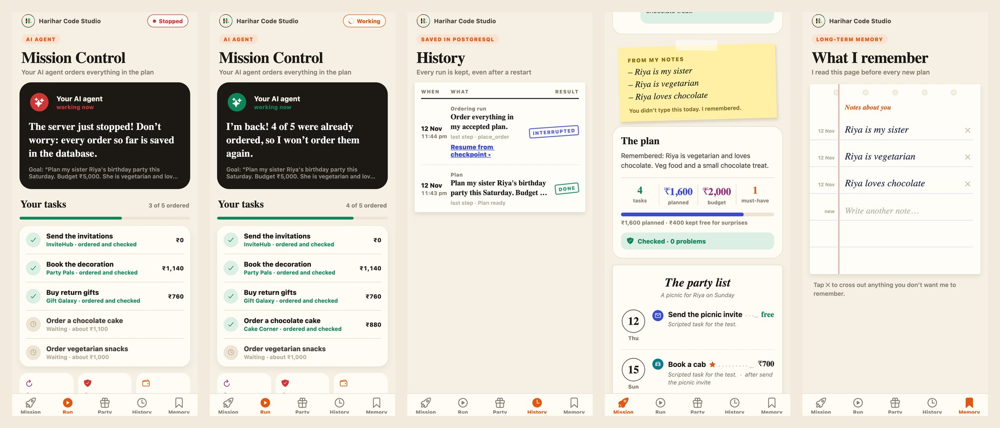
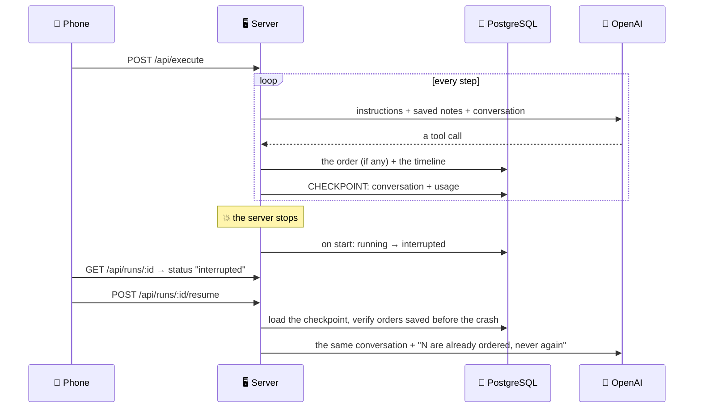

# 🧭 Mission Control: Memory & State

### Experiment 07 · Part 4: Checkpoint, Resume, Remember


> **Kill the server in the middle of an order. The agent comes back, skips what is already done, and never pays twice.**

In Part 3 the agent ordered a whole birthday party, but everything lived in the server's memory. Stop the server and the work was gone: half-finished runs, the orders, the history. Running it again could even order the cake a second time. Part 4 gives the agent a memory, in **PostgreSQL**:

- **Short-term memory = the checkpoint.** After every finished step, the agent's whole conversation with the model is saved. After a crash, **Resume** continues from there.
- **Long-term memory = a diary about you.** Tell it once that *"Riya is vegetarian and loves chocolate"*, and every later plan respects it, even when the new goal says nothing about food.



```text
GOAL      Run the plan · 5 things to order · budget ₹5,000
ACT       place_order(t1, InviteHub)        → order #1041   ✓ verified
ACT       place_order(t2, Party Pals)       → order #1042   ✓ verified
💥        Ctrl+C: the server stops
          npm run demo → "PostgreSQL connected. 1 interrupted run: open the app to resume."
RESUME    Resumed after restart · 2 of 5 already ordered: not ordered again · 3 left · ₹4,430 left
DECIDE    I'll order the chocolate hampers from Gift Galaxy: they match Riya's love of chocolate.
ACT       place_order(t3, Gift Galaxy)      → order #1043   ✓ verified
…
DONE      All 5 things ordered · ₹3,480 of ₹5,000 · nothing ordered twice
```

### ✨ Highlights

- 🐘 **PostgreSQL store:** runs, the timeline, plans, orders, the budget and memory all live in the database. The agent talks to a small `Store` interface and never knows which database is behind it.
- 💾 **Checkpoint:** saved only when every tool call of a step has its answer. A half-written step is never saved.
- 🔌 **Interrupted, not lost:** when the server starts, every run still marked `running` is marked `interrupted`. The phone shows **Resume**.
- ▶️ **Resume:** the same run id, the same conversation, the same spending so far. The step and time budgets keep counting.
- 🔒 **Never pay twice:** two locks. The order list is in the database, so an ordered task is refused. And an order saved just before the crash is verified on resume, not ordered again.
- 📔 **Long-term memory:** after a plan, a small prompt picks out notes that will still be true tomorrow (who you plan for, diet, favourite flavours) and saves them. The next plan reads them first.
- 📱 **Two new tabs:** **History** (every run as a logbook, with a Resume link on interrupted runs) and **Memory** (a notebook page: cross a note out, or write your own).
- ✅ **51 tests:** the same store tests run on the in-memory store and on real PostgreSQL (PGlite, nothing to install), including a "power cut" in the middle of a run.

This is Part 4 of the [Personal AI Mission Control](../README.md) series. It is built directly on [Part 3](../part-3/README.md): same party agent, same shops, same safety nets.

---

## 📑 Table of Contents

- [Core Concept](#-core-concept)
- [Series Roadmap](#-series-roadmap)
- [How It Works](#-how-it-works)
- [The Database](#-the-database)
- [The Code](#-the-code)
- [API](#-api)
- [Project Structure](#-project-structure)
- [Backend Setup](#-backend-setup)
- [Labs](#-labs)
- [Test the Backend](#-test-the-backend)
- [Run the Mobile Application](#-run-the-mobile-application)
- [Try the Crash](#-try-the-crash)
- [Troubleshooting](#-troubleshooting)
- [Security](#-security)
- [What We Learned](#-what-we-learned)
- [About Harihar Code Studio](#-about-harihar-code-studio)

---

## 💡 Core Concept

> **Like a video game: when the power goes, you restart from the last checkpoint, not from level 1.**

| | Part 3 | Part 4 |
| --- | --- | --- |
| Where data lives | The server's memory | PostgreSQL |
| Server restart | Everything is gone | Runs come back as `interrupted`, ready to resume |
| Mid-run crash | Start again, maybe order twice | Resume from the checkpoint, skip what is ordered |
| You | Repeat your preferences every time | Saved once as notes, read before every plan |
| History | None | Every run, plan and order, kept |

---

## 🗺 Series Roadmap

| Part | Topic | What the app gains |
| --- | --- | --- |
| P1 | Intro to Agentic AI | The agent loop with three tools |
| P2 | Planning Engine | Goal → a checked, repaired, ordered plan |
| P3 | Execution Loop | The plan carried out: orders within budget, retry, verify, loop guard |
| **P4** | **Memory & State** | **PostgreSQL, checkpoints, resume, long-term memory (this folder)** |
| P5 | Human-in-the-Loop | Policy engine, approvals, grants, expiry |
| P6 | Multi-Agent Team | Researcher + Planner + Executor, orchestrator, report |

---

## 🔄 How It Works



**Long-term memory** works around the planner:

1. Before planning, the saved notes are put in front of the goal: *"Saved notes about the user (always respect them): – Riya is vegetarian …"*
2. After the plan is made, `extractNotes` reads the goal and keeps only facts that will still be true for future plans. Dates, this budget and the goal itself are not kept. A memory problem never blocks the plan.
3. The executor gets the same notes, so it picks the shop whose item fits them (the chocolate cake, the vegetarian snacks).

---

## 🐘 The Database

`server/sql/001_init.sql` runs on every start. Every statement is `if not exists`, so running it twice is safe.

| Table | What it keeps |
| --- | --- |
| `runs` | Every run (`plan`, `execute`, `agent`), its status (`running`, `done`, `failed`, `interrupted`), its usage and its **checkpoint** |
| `run_events` | The timeline the phone shows, one row per step |
| `plans` | The plan the AI made, its order, and the notes it read |
| `tasks` | The accepted plan's things to order and the **order** placed for each (`purchase`) |
| `settings` | Small values, like the budget of the accepted plan |
| `memory` | Long-term notes about you, one sentence each |

---

## 🧩 The Code

| File | What it does |
| --- | --- |
| `server/sql/001_init.sql` | **New.** The tables |
| `server/src/store/pg.ts` | **New.** The PostgreSQL `Store`: runs, events, tasks, plans, `markInterrupted`, `saveCheckpoint` / `loadCheckpoint`, notes |
| `server/src/store/memory.ts` | The in-memory `Store` (moved from `store.ts`), kept for tests |
| `server/src/db.ts` | **New.** Connects to `DATABASE_URL` and runs the migration |
| `server/src/memory.ts` | **New.** `extractNotes` (what to remember) and `notesBlock` (what the planner and executor read) |
| `server/src/execute.ts` | The checkpoint after every finished step, `resume`, verify-on-resume, and the "never order it twice" refusal |
| `server/src/plan.ts` | Reads the notes before planning, saves new ones after |
| `server/src/app.ts` | `GET /api/runs`, `POST /api/runs/:id/resume`, `GET/POST/DELETE /api/memory` |
| `server/src/index.ts` | On start: connect, migrate, mark interrupted runs |
| `server/test/store.test.ts`, `resume.test.ts` | **New.** The same tests on both stores, the power cut, memory, the API |
| `mobile/app/(tabs)/history.tsx` | **New History tab:** the logbook, with Resume on interrupted runs |
| `mobile/app/(tabs)/memory.tsx` | **New Memory tab:** the notebook page |
| `mobile/app/(tabs)/run.tsx` | "The server just stopped" while it is down, and the **Checkpoint saved** panel with Resume |
| `mobile/src/components/PlanView.tsx` | The **From my notes** sticky note on a plan that used memory |

---

## 📡 API

New in Part 4 (everything from Part 3 still works):

| Method | Path | Body | Returns |
| --- | --- | --- | --- |
| `GET` | `/health` | — | `{ "ok": true, "part": 4, "store": "postgres" }` |
| `GET` | `/api/runs` | — | `{ "runs": [{ id, kind, goal, status, createdAt, last }] }`, newest first |
| `POST` | `/api/runs/:id/resume` | — | `202 { "id" }`. `409` if the run isn't interrupted or isn't an ordering run |
| `GET` | `/api/memory` | — | `{ "notes": [{ id, content, createdAt }] }` |
| `POST` | `/api/memory` | `{ "content": "…" }` | `201 { "note" }`. `409` if it is already remembered |
| `DELETE` | `/api/memory/:id` | — | `{ "ok": true }` |

---

## 🗂 Project Structure

```text
experiment-07/
└── part-4/
    ├── README.md
    ├── docs/screens.jpg
    ├── server/
    │   ├── sql/001_init.sql             ← new
    │   ├── labs/ 01 … 07, 08-restart.ts ← new: npm run lab:8
    │   ├── src/
    │   │   ├── store/  index.ts  memory.ts  pg.ts   ← new folder
    │   │   ├── db.ts  memory.ts                     ← new
    │   │   ├── execute.ts  plan.ts  app.ts  index.ts
    │   │   └── shops.ts  tools.ts  agent.ts  llm.ts  schemas.ts  clock.ts  types.ts
    │   └── test/
    │       ├── store.test.ts  resume.test.ts  pg.ts  ← new
    │       └── execute.test.ts  plan.test.ts  agent.test.ts  helpers.ts
    └── mobile/
        └── app/(tabs)/  index.tsx  run.tsx  party.tsx  history.tsx  memory.tsx
```

---

## ⚙️ Backend Setup

Requirements: Node 20+, PostgreSQL 14+ and an OpenAI API key.

```bash
brew install postgresql@16 && brew services start postgresql@16   # once
createdb mission_control                                           # once

cd ai/experiment-07/part-4/server
npm install
cp .env.example .env
```

`.env`:

```text
OPENAI_API_KEY=your-key-here
AGENT_MODEL=gpt-6-luna
PORT=3007
DATABASE_URL=postgres://localhost:5432/mission_control
# DEMO_PACE_MS=4000   ← recording only: a 4 s pause after every checked order
```

```bash
npm run dev    # watch mode, for coding
npm run demo   # no watch mode: Ctrl+C stops the server at once (use this to try the crash)
```

You should see `PostgreSQL connected.` Without `DATABASE_URL` the server runs in memory and forgets everything on restart, like Part 3.

---

## 🧪 Labs

| Command | Shows |
| --- | --- |
| `npm run lab:8` | A real model starts ordering with two notes about Riya, "dies" after two steps, is marked interrupted and resumed. Uses your `DATABASE_URL`, or PGlite if it isn't set |
| `npm run lab:1` … `lab:7` | The labs from Parts 1–3 |

---

## ✅ Test the Backend

```bash
npm test           # 51 tests, fake model, no key and no database needed
npm run typecheck
```

| Tests | Check |
| --- | --- |
| Store (×2) | The same 8 tests on the in-memory store and on real PostgreSQL (PGlite) |
| Resume | The model "dies" after 2 orders → interrupted → resume orders only the rest, the old orders keep their ids |
| Verify on resume | An order saved just before the crash is verified, not ordered again |
| Memory | The planner reads saved notes and saves new ones; a broken memory step never blocks the plan |
| The API | History, resume rules, memory add / duplicate / delete |
| Parts 1–3 | All earlier tests still pass |

---

## 📱 Run the Mobile Application

```bash
cd ai/experiment-07/part-4/mobile
npm install
EXPO_PUBLIC_API_URL=http://<your-mac-ip>:3007 npx expo start
```

On the iOS Simulator `http://localhost:3007` works; on the Android Emulator use `http://10.0.2.2:3007`.

---

## 💥 Try the Crash

1. **Mission** → *"Plan my sister Riya's birthday party this Saturday. Budget ₹5,000. She is vegetarian and loves chocolate."* → **Make my plan**. Open **Memory**: the notes are there.
2. **Accept this plan** → **Let the agent do it**.
3. After two green ticks, press **Ctrl+C** in the server terminal. The app says *"The server just stopped!"*.
4. `npm run demo` again. The terminal says *1 interrupted run*, and the app shows **Checkpoint saved** with **Resume**.
5. Tap **Resume**. Nothing already ordered is ordered again. Check **Party** and **History**.
6. **Mission** → *"Plan a picnic for Riya on Sunday. Budget ₹2,000."* The plan carries a **From my notes** sticky note: veg food and a chocolate treat, without you saying so.

To start clean: `dropdb mission_control && createdb mission_control`, then restart the server.

---

## 🛠 Troubleshooting

| Problem | Fix |
| --- | --- |
| `Could not start: connect ECONNREFUSED` | PostgreSQL isn't running: `brew services start postgresql@16` |
| `database "mission_control" does not exist` | `createdb mission_control` |
| Everything gone after a restart | `DATABASE_URL` is missing from `server/.env` |
| No Resume button | Open the **History** tab: interrupted ordering runs have *Resume from checkpoint* |
| The run finished before Ctrl+C | Set `DEMO_PACE_MS=4000` in `.env` and use `npm run demo` |
| `401` from OpenAI | Put a current key in `server/.env` and restart the server |
| iOS build fails in `expo-modules-jsi` on Xcode 26 | Run `npm install` again in `mobile/`, which reapplies the fix in `patches/` |

---

## 🔒 Security

- The OpenAI key and the database URL live only in `server/.env`, which git ignores. The phone never sees them.
- Every query uses parameters (`$1`, `$2`), never string building.
- A bad id is simply "not found", never a database error.
- Memory is yours: you can see every note, delete it, or add your own.
- The shops are still pretend: no real orders, no real money.

---

## 🎓 What We Learned

- State that matters belongs in a database, not in a variable.
- Save a checkpoint only when a step is complete. Half a step can't be resumed.
- A server can't know it crashed, but on start it can see what never finished.
- "Never twice" needs a lock in the data, not a promise in the prompt.
- Long-term memory is a filter: keep what stays true, drop the one-time details.

---

## 🎓 About Harihar Code Studio

**Harihar Code Studio** focuses on practical software engineering tutorials covering:

`React Native` · `Mobile Engineering` · `Artificial Intelligence` · `LLM Integrations` · `AI Architecture` · `Developer Tools` · `Production Engineering`

The goal is to understand not only **how** to implement a feature, but also the **architecture and engineering decisions** behind it.
