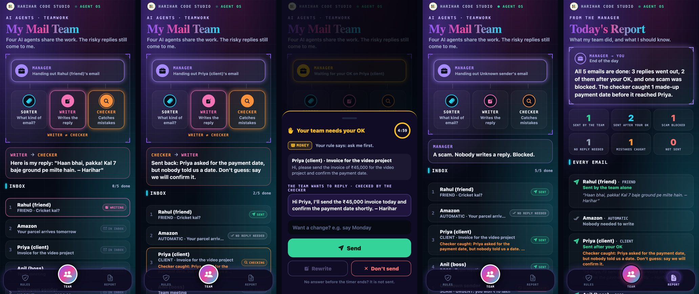
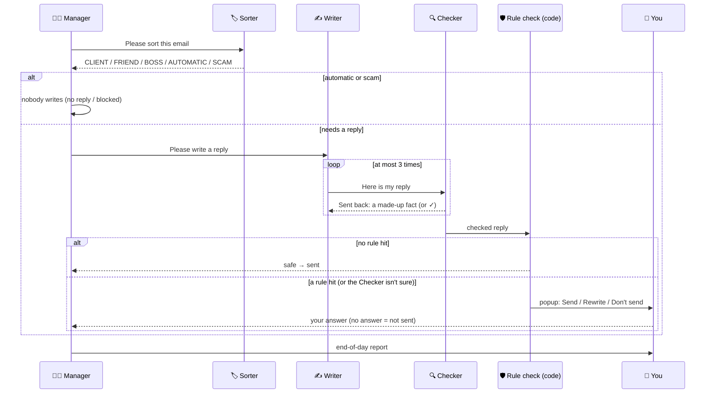

# 🧭 Mission Control: Multi-Agent Team

### Experiment 07 · Part 6: A Team of AI Agents Replies to My Emails


> **One agent per job. One agent checks another. Risky replies still come to you.**

🎬 This folder is the code from the video **"Multi-Agent AI Explained in Hindi"** on **Harihar Code Studio**.

My inbox is no longer handled by one AI. A **team of four AI agents** shares the work:

| Agent | Its one job |
| --- | --- |
| 🧑‍💼 **Manager** | Hands out the work, decides who works next, writes the end-of-day report |
| 🏷 **Sorter** | Reads an email and says what kind it is: friend, client, boss, automatic or scam |
| ✍️ **Writer** | Writes the reply: fast, like a new intern, and it sometimes guesses |
| 🔍 **Checker** | A strict teacher with one job: catch made-up facts (a date, time or amount nobody gave us) and send the reply back |

Before anything is sent, **our code** (not an agent) still checks three rules: **money**, a **meeting**, or a **stranger**. If a rule hits, the team stops and your phone shows a popup: **Send**, **Rewrite** (with a note) or **Don't send**. No answer before the timer ends means nothing is sent.



```text
EMAIL 1  Rahul (friend)   Sorter: FRIEND     → Writer → Checker ✓ → no rule hit      → SENT by the team
EMAIL 2  Amazon           Sorter: AUTOMATIC  → nobody writes                        → no reply needed
EMAIL 3  Priya (client)   Sorter: CLIENT     → Writer guesses a payment date
                          Checker: "Nobody told us the payment date. Don't guess it." → SENT BACK
                          Writer fixes it → Checker ✓ → rule: MONEY → popup → you tap Send
EMAIL 4  Anil (boss)      Sorter: BOSS       → Writer → Checker ✓ → rule: MEETING → popup → Send
EMAIL 5  Unknown sender   Sorter: SCAM       → Manager blocks it, nobody writes      → SCAM BLOCKED
REPORT   1 sent by the team · 2 after your OK · 1 scam blocked · 1 no reply · 1 mistake caught
```

### ✨ Highlights

- 👥 **Four agents, one model:** each agent is the same model with **different instructions**. That is what makes them a team.
- 💬 **Handoffs as messages:** every step is a message (`Manager → Sorter`, `Writer → Checker`, `Checker → Writer: Sent back`…), shown live in the **Team chat**.
- 🔍 **AI checks AI:** the Checker catches the Writer's guesses before they reach anyone.
- ♾ **Loop limit:** Writer ⇄ Checker runs at most **3** times. If they still can't agree, the team **asks you**. It never sends, and never quietly skips.
- 🛡 **Rules stay in code:** the team is smart, but `checkReply` decides when you must be asked. Blocking a scam is safe, so the team may do it alone. Sending is risky.
- 📝 **Manager's report** at the end: counts, one line per email, and what the Checker caught.
- 📱 **New app screens:** **Team** (four glowing desks, the live handoff, the inbox, the team chat) and **Report**.
- ✅ **74 tests**, including the full demo story, the Checker's catch, the loop limit, a rule switched off, and the timer.

This is Part 6 of the [Personal AI Mission Control](../README.md) series, built on [Part 5](../part-5/README.md). The video stands on its own: no earlier part is needed to follow it.

---

## 🗺 Series Roadmap

| Part | Topic | What the app gains |
| --- | --- | --- |
| P1 | Intro to Agentic AI | The agent loop with three tools |
| P2 | Planning Engine | Goal → a checked, repaired, ordered plan |
| P3 | Execution Loop | Orders within budget, retry, verify, loop guard |
| P4 | Memory & State | PostgreSQL, checkpoints, resume, long-term memory |
| P5 | Human-in-the-Loop | An email agent that asks before money, meetings or strangers |
| **P6** | **Multi-Agent Team** | **Manager + Sorter + Writer + Checker, handoffs, report (this folder)** |

---

## 🔄 How It Works



---

## 🧩 The Code

| File | What it does |
| --- | --- |
| `server/src/team.ts` | **New.** The whole team: the four agents' instructions (`SORTER`, `WRITER`, `CHECKER`, `MANAGER`), the Manager's routing, `draftAndCheck` (Writer ⇄ Checker, max 3), the rule check + `ask` (popup with a timer), the report, and the `/api/team` routes |
| `server/src/mail.ts` | The 5 inbox emails and `checkReply`: the three rules, in plain code (shared with Part 5) |
| `server/src/llm.ts` | Talks to OpenAI with Structured Outputs. Every agent is one `parse` call with its own instructions |
| `server/labs/11-team.ts` | **New.** Runs the team with the real model and prints every handoff (`npm run lab:11`) |
| `server/test/team.test.ts` | **New.** The demo story, the Checker's catch, your note, a rule off, no answer, the loop limit, validation |
| `mobile/app/(tabs)/index.tsx` | **New Team screen:** the Manager on top, three specialists below, the live handoff, the inbox and the team chat |
| `mobile/app/(tabs)/sent.tsx` | **New Report screen:** the Manager's summary, counts, one line per email |
| `mobile/src/mail.ts` | The phone's client for `/api/team`, plus the colours of each agent, rule and stage |
| `mobile/src/components/MailSheet.tsx` | The popup: "Your team needs your OK" |

The heart of it, simplified:

```ts
for (const email of INBOX) {
  const { label } = await sorter(email);                 // 🏷 what kind of email?
  if (label === "automatic") continue;                   // nobody needs to write
  if (label === "scam") { block(email); continue; }      // blocking is safe: no question needed

  const draft = await draftAndCheck(email);              // ✍️ ⇄ 🔍 at most 3 rounds
  const hits = checkReply(email, draft.reply, rules);    // 🛡 OUR CODE, not an agent
  if (!draft.ok) hits.push("checker");                   // they couldn't agree → you decide
  if (!hits.length) send(draft.reply);
  else await ask(email, draft.reply, hits);              // 📱 popup: Send / Rewrite / Don't send
}
report();                                                // 🧑‍💼 the Manager's summary
```

---

## 📡 API (new in Part 6)

| Method | Path | Body | Returns |
| --- | --- | --- | --- |
| `GET` | `/api/team` | — | `{ items, msgs, agents, rules, question, running, report, ttl }` |
| `PUT` | `/api/team/rules` | `{ money, meeting, stranger }` (true / false) | `{ rules }`, `400` if invalid |
| `POST` | `/api/team/start` | — | starts the inbox from the top |
| `POST` | `/api/team/answer` | `{ decision: "send" \| "rewrite" \| "skip", note }` | `{ ok }`, `409` if nothing is waiting |
| `POST` | `/api/team/reset` | — | clears the inbox, the chat and the report |

The Part 5 email agent (`/api/mail`) and the Mission Control API from Parts 1–5 are still in the server.

---

## ⚙️ Setup

Node 20+ (22 recommended) and an OpenAI key. No database is needed for the team demo.

```bash
# Terminal 1: server
cd ai/experiment-07/part-6/server
cp .env.example .env        # add your OPENAI_API_KEY
npm install && npm run demo # "Mission Control · Part 6 · http://localhost:3007"

# Terminal 2: app
cd ai/experiment-07/part-6/mobile
npm install && npx expo start -c --localhost   # then press i
```

| `.env` | Meaning |
| --- | --- |
| `OPENAI_API_KEY`, `AGENT_MODEL` | The model every agent uses (Structured Outputs) |
| `APPROVAL_TTL_S=300` | How long the popup waits for you (seconds) |
| `TEAM_PACE_MS=1500` | Pause between steps, so you can watch the handoffs |
| `TEAM_FAKE=1` | Scripted agents: the same story every time, no OpenAI key needed |

| Command | Shows |
| --- | --- |
| `npm test` | 74 tests, fake model, no key needed |
| `npm run lab:11` | The team with the real model: every handoff printed, popups answered with "send" |

---

## 🙋 Try It

1. **Rules** tab: money, meeting and stranger are ON.
2. **Team** tab → **Give the inbox to my team**. Watch the desks light up.
3. Email 3: the Writer guesses a payment date, the Checker sends it back, the fixed reply hits the money rule → **Send**.
4. Email 4: the meeting rule → **Send**. Email 5: the Sorter calls it a scam, the Manager blocks it.
5. Scroll down: **Team chat** shows every message. Then open **Report**.
6. Experiment: switch the **meeting** rule off and **Start again**. The boss's reply goes out without asking.

---

## 🔒 Security

- The rules are checked by **our code** before every send. No agent can talk its way past them.
- Blocking is safe, so the team may block alone. Sending is risky, so it needs the rules, and maybe you.
- Writer ⇄ Checker is limited to 3 rounds. If they can't agree, you decide; nothing goes out on its own.
- No answer before the timer ends means **not sent**.
- The inbox is pretend: nothing is really emailed.

---

## 🎓 What We Learned

- A team beats one giant prompt: small instructions, one job each.
- The same model with different instructions makes different agents.
- Agents talk through messages, and a log of those messages makes mistakes easy to find.
- AI can check AI: a Checker with a narrow job catches the Writer's guesses.
- Every loop needs a limit, and every unsure moment needs a human.
- Teams cost more calls: use one when the job needs different skills or a mistake is expensive.

---

## 🎓 About Harihar Code Studio

**Harihar Code Studio** focuses on practical software engineering tutorials covering:

`React Native` · `Mobile Engineering` · `Artificial Intelligence` · `LLM Integrations` · `AI Architecture` · `Developer Tools` · `Production Engineering`

The goal is to understand not only **how** to implement a feature, but also the **architecture and engineering decisions** behind it.
