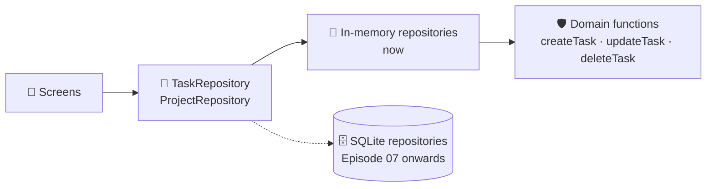

# 📋 PlanIt: Navigation + CRUD

### Episodes 05–06: Build the PlanIt UI and React Native CRUD with TypeScript


> **Screens talk to an interface. They don't know where the data lives.**

🎬 This folder is the code from **Episodes 05 and 06** of the **Offline-First / Local-First** series on **Harihar Code Studio**.

PlanIt becomes a real app here: projects, tasks, typed navigation, and create / read / update / delete from the screens. It is built on the [Episode 04](../episode-04/README.md) data models.

### ✨ Highlights

- 🧭 **Typed navigation:** one `RootStackParamList`. Wrong screen params are a compile error.
- 🏠 **Home dashboard:** today's numbers, and every project with its progress.
- ✅ **Full task CRUD:** create, edit, complete and delete. One bottom sheet handles both create and edit.
- 🔎 **Search, filter and sort** in the repository, not in the screen.
- 📊 **Overview:** All / To do / Today / Done tasks across every project.
- 🛡 **Same Zod schemas** in the form and in the domain, with a message per field.
- 🔁 **One state at a time:** `loading`, `error` or `success`, as a discriminated union.
- 🪦 **Soft delete:** a delete sets a tombstone, so it can sync later.
- 🌗 **Light and dark theme.**
- 🧪 **32 tests**, including the whole CRUD flow through the real screens.

> ⚠️ Data is kept **in memory**: it resets when the app closes. SQLite comes in Episode 07.

---

## 🔄 How It Works



`src/app/repositories.ts` is the one place that decides where data lives:

```ts
export const repositories = {
  tasks: new InMemoryTaskRepository(seedTasks, { delayMs: 250 }),
  projects: new InMemoryProjectRepository(seedProjects, { delayMs: 250 }),
};
```

### Screens

| Screen | Route | Opens as | What it does |
| --- | --- | --- | --- |
| Home | `Home` | Root screen | Summary cards and projects with progress |
| Tasks | `Tasks` | Push | One project's tasks: search, filter, complete |
| Overview | `Overview` | Push | Tasks across all projects |
| Task editor | `TaskEditor` | Bottom sheet | No `taskId` = create, `taskId` = edit (and delete) |
| New project | `NewProject` | Bottom sheet | Creates a project and opens it |

---

## 📁 File Structure

```text
episode-05-06/
├── README.md
└── PlanIt/
    ├── apps/PlanItMobile/
    │   ├── App.tsx                        theme, status bar, navigator
    │   ├── index.js                       random source for uuid (first import)
    │   ├── jest.setup.js                  native module mocks
    │   ├── __tests__/
    │   │   ├── App.test.tsx               app renders
    │   │   ├── crudFlow.test.tsx          CRUD through the real screens
    │   │   ├── dates.test.ts              due dates
    │   │   ├── domainModels.test.ts       project and task models
    │   │   ├── overview.test.tsx          cross-project lists
    │   │   └── taskRepository.test.ts     CRUD, filter, search, sort
    │   └── src/
    │       ├── app/
    │       │   ├── navigation.tsx         routes and typed params
    │       │   ├── repositories.ts        where data lives
    │       │   └── seed.ts                starter data
    │       ├── assets/                    logo
    │       ├── features/
    │       │   ├── projects/
    │       │   │   ├── data/              ProjectRepository + in-memory version
    │       │   │   ├── domain/            project model
    │       │   │   └── screens/           Home, NewProject
    │       │   └── tasks/
    │       │       ├── components/        TaskCard
    │       │       ├── data/              TaskRepository + in-memory version, mappers
    │       │       ├── domain/            task model
    │       │       └── screens/           TaskList, TaskEditor, TaskOverview
    │       └── shared/
    │           ├── data/                  delay / failure simulation
    │           ├── domain/                IDs, time, base schemas, field errors
    │           ├── lib/                   due dates and date labels
    │           └── ui/                    theme, controls, icons, state views, useScreenData
    ├── server/                            Express API (unchanged since Episode 04)
    │   └── database/migrations/           PostgreSQL migrations 001, 002
    ├── docs/                              data model reference
    ├── images/                            Episode 03 diagrams
    └── docker-compose.yml                 local PostgreSQL
```

The Episode 04 teaching screens (`src/dev/`, Sync Lab) are not part of this app. They stay in [episode-04](../episode-04/README.md).

---

## ⚙️ Setup

Node 22.11+ and Xcode (or Android Studio). The server and database are **not needed** for this episode.

```bash
cd offline_first/episode-05-06/PlanIt/apps/PlanItMobile
npm install
cd ios && bundle install && bundle exec pod install && cd ..
npm run ios                 # or: npm run android
npm test                    # 32 tests
```

| New package | Why |
| --- | --- |
| `@react-navigation/native`, `@react-navigation/native-stack` | Native stack navigation |
| `react-native-screens` | Native screens and bottom sheets |
| `react-native-svg` | Icons and gradients |

`react-native-screens` and `react-native-svg` are **native modules**: run `pod install` and rebuild, a Metro reload is not enough.

---

## 🙋 Try It

1. Open **Personal**: three tasks, one done.
2. Tap **+** and save with an empty title: "Title is required".
3. Add a task with a priority and a due date. It appears in the list.
4. Edit it and save. Open it again: the version went up.
5. Complete it, then use the **All / Active / Done** filters and the search bar.
6. Delete it. It is hidden by a tombstone, not removed.
7. On Home, tap a summary card to see tasks across all projects.

---

## 🎓 What We Learned

- Type the routes once, and TypeScript checks every `navigate` call.
- Put an interface between the screens and the data, so storage can change later.
- Make repository methods async from day one, because SQLite and APIs are.
- Keep the rules (IDs, versions, soft delete) in the domain, not in the screens or the repository.
- Model screen state as one value, not three booleans.
- Ignore an old response that arrives after a newer one.

---

## 🎓 About Harihar Code Studio

**Harihar Code Studio** focuses on practical software engineering tutorials covering:

`React Native` · `Mobile Engineering` · `Offline-First Architecture` · `Sync Engines` · `Databases` · `Developer Tools` · `Production Engineering`

The goal is to understand not only **how** to implement a feature, but also the **architecture and engineering decisions** behind it.
